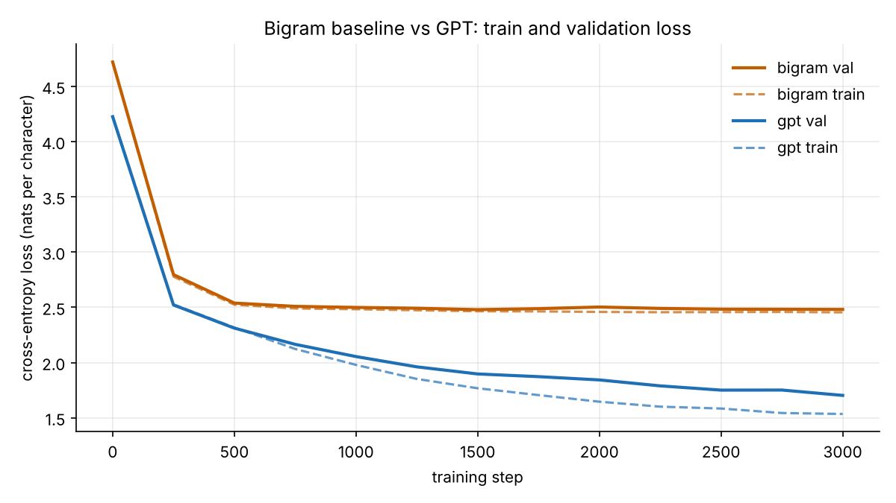

# Day 007: tiny-gpt

**Date:** 2026-11-11

## What it does

A character-level GPT written from scratch in PyTorch (no Hugging Face, no `nn.Transformer`) and trained on CPU in about 8 minutes. It learns to write Shakespeare-ish text one character at a time, and it ships with a bigram baseline so you can see how much the attention layers actually buy you.

## Why I built it

I use language models every day and wanted to know what is inside one. Writing the attention head by hand, line by line, was the quickest way to find out. The bigram baseline answers the follow-up question: how much of the improvement comes from looking at context?

## Tech used

- Python 3.10+, PyTorch (CPU), matplotlib
- pytest and pytest-cov (99% coverage, suite runs in about 5 seconds)
- GitHub Actions (CPU torch, fails under 85% coverage)

## How to run

```bash
cd day-007-tiny-gpt
pip install -r requirements.txt          # CPU torch + matplotlib
python train.py --steps 3000             # ~8 min on 4 CPU cores, saves checkpoints/gpt.pt
python train.py --model bigram           # baseline to compare against
python generate.py --prompt "ROMEO:" --tokens 400 --temperature 0.8 --top-k 40 --seed 7
```

Training prints the parameter count and tokens/sec, evaluates train and val loss every 250 steps, appends to `runs/loss.csv`, saves the best checkpoint by val loss and redraws `docs/loss.png`. Run `python plot.py` to redraw the plot on its own.

Data: tinyshakespeare is downloaded from GitHub raw on first run and cached in `data/`. If the download fails, a small bundled public domain text (`assets/fallback.txt`, a few Shakespeare excerpts) is used so everything still runs offline. Use `--offline` to skip the download on purpose. The dataset and checkpoints are git-ignored.

```bash
pip install -r requirements-dev.txt
python -m pytest --cov --cov-fail-under=85
```

## Files

| File | What it holds |
|------|---------------|
| `tokenizer.py` | Character tokenizer with a saved vocab (`vocab.json`) |
| `data.py` | Download with offline fallback, 90/10 split, random batch sampler |
| `models.py` | Bigram baseline and the GPT (`Head`, `MultiHeadAttention`, `FeedForward`, `Block`, `GPT`) |
| `train.py` | AdamW loop, periodic eval, CSV log, best checkpoint |
| `generate.py` | Temperature and top-k sampling, `--seed`, loads from checkpoint |
| `checkpoint.py` | Save and load weights, config and vocab together |
| `plot.py` | `runs/loss.csv` to `docs/loss.png` |

## How a GPT works

The model reads a window of characters and predicts the next one at every position. Each character id becomes a vector (token embedding plus a position embedding), then flows through a stack of identical transformer blocks, and a final linear layer turns each vector into a score for every character in the vocabulary.

One block (pre-norm, as used here):

```text
        x  (B, T, C)
        |
        +------------------------+
        |                        |
   LayerNorm                     |
        |                        |
  Multi-head causal              |
  self-attention                 |
   (each position looks          |
    only at itself and           |
    earlier positions)           |
        |                        |
     dropout                     |
        |                        |
        (+)<---------------------+   residual add
        |
        +------------------------+
        |                        |
   LayerNorm                     |
        |                        |
  Feed-forward MLP               |
   C -> 4C -> GELU -> C          |
   (per position, no mixing)     |
        |                        |
     dropout                     |
        |                        |
        (+)<---------------------+   residual add
        |
        y  (B, T, C)
```

Inside one attention head, every position `t` produces a query `q_t`, a key `k_t` and a value `v_t`:

```text
scores  = q @ k^T / sqrt(head_size)       (B, T, T)   how much t cares about each s
scores  = scores with s > t set to -inf                the causal mask: no peeking ahead
weights = softmax(scores)                              each row sums to 1
out     = weights @ v                                  weighted average of the values
```

The whole model, with the default config (1,014,593 parameters):

```text
characters -> token emb (65 x 128) + position emb (64 x 128)
           -> Block x 5   (4 heads of size 32 each)
           -> LayerNorm -> Linear (128 -> 65) -> next-character scores
```

Residual connections let gradients flow straight through the stack, LayerNorm keeps activations well scaled, and the mask is what makes it a language model: changing a future character can never change the output at an earlier position (there is a test for exactly that).

## Results

Same data, same 3000 steps, same seed, validation loss is cross-entropy in nats per character (lower is better; a uniform guess over 65 characters is ln 65 = 4.17).

| Model | Parameters | Best val loss | Final train loss | Tokens/sec (CPU) |
|-------|-----------:|--------------:|-----------------:|-----------------:|
| Bigram baseline | 4,225 | 2.4791 | 2.4544 | about 1.5M |
| GPT (5 layers, 4 heads, 128 dim) | 1,014,593 | **1.7027** | 1.5345 | about 13K |

The GPT cuts validation loss by 0.78 nats, which means it assigns each true next character roughly 2.2 times the probability the bigram does (e^0.78). The bigram flattens out by step 500 because a single character of context has nothing more to teach it. The GPT is still improving at step 3000, and the gap between its train and val curves (1.53 vs 1.70) shows it is starting to overfit the 1 MB corpus a little.



## Samples

All generated with `--prompt "ROMEO:" --tokens 400 --top-k 40 --seed 7`, differing only in temperature.

**Temperature 0.5** (conservative: fluent word shapes, but it loops on common words like "the")

```text
ROMEO:
Good my lord: lord, I will not see the father,
For that the set bear to me have shall the speak?

LEONTES:
No, and the have is the save as the severeign with your soon the in so,
The maves my state and the day and not the subjection
And the word, for the will tears of so force, and I shall the king.

LEONTES:
I have lords thee some the heaven straight and the haster and
And is the days of the of 
```

**Temperature 0.8** (the sweet spot: plays and speakers appear, some real lines)

```text
ROMEO:
God and scorn lord, let severn server to him be now the
that me bead to weep, and is a charity, but and you had
I am the flike these of the law reged will the childs
not as very, what sir.

WARWICK:
Yet the good in the sovereign do
To a king! then meat the chip of honour eye.

AUFIDIUS:
Why, the soul,
Would less as the hath upon and him.

CLARENCE:
How my move strenge as we is to somether brother
```

**Temperature 1.1** (adventurous: invented words, spelling starts to fall apart)

```text
ROMEO:
Go's make me: lord, let severn server to him be kill'
me with tork do whate you shup a ch'd deby, that a consul,
Hath he is king; to 'tis not and goody looks your
sson that vrissed; was blam my faulty: put in their son?

ROMEO:
You
Tajust cle than Buckingblo;
Never manness, confectime. In thou knaring, Gentll'ster-krengest,
And the grace doth speak honourse these with as waiis
Against to brother'
```

**For comparison, the bigram baseline at temperature 0.8** (it only sees one character, so it gets letter pairs right and nothing else)

```text
ROMEO:
Go's matocos:
ENook l ftoe y S:
SESere f here f mee t mer s ber bord be weemy f s is a che pl bersthandave e maldr:

Fir ol t t fat ave fonelar r ge swilouthurandesson thasivr;
GLOLE:
Rirs m mpthakeend, urt berd in tond, thed ancis
TENar s le t,
Theret the yomanonoron n arorcouedowing. Indrirs?
War
```

## What I learned

- Attention is a small amount of code. The causal head is about ten lines, and almost everything else is plumbing around it.
- The bigram baseline is worth building first. It gives you a number to beat and makes the GPT's improvement concrete instead of a vibe.
- On CPU the per-head Python loop is the bottleneck, not the FLOPs. Shrinking the context to 64 characters and the batch to 32 is what kept training under 10 minutes.
- Temperature and top-k change the character of the output far more than I expected from two one-line changes to the logits.
- Testing a language model is possible without training one: the causal mask, shapes, seed determinism, top-k=1 equals greedy and checkpoint roundtrips are all cheap, exact checks.

## Ideas to extend

- Vectorize the heads into one batched matmul and compare speed against the readable per-head version.
- Tie the token embedding and output layer weights.
- Add a learning rate schedule (warmup plus cosine decay) and train longer.
- Try a byte-pair tokenizer and see how loss per token and per character change.
- Cache keys and values during generation so sampling stops recomputing the whole window.

## Author

**Jashwanth Neela** · [GitHub](https://github.com/NJashwanth)
