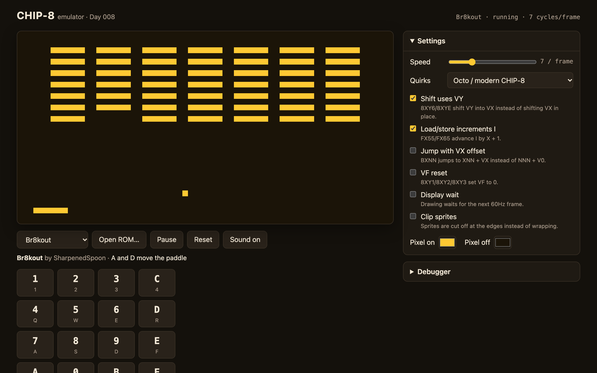
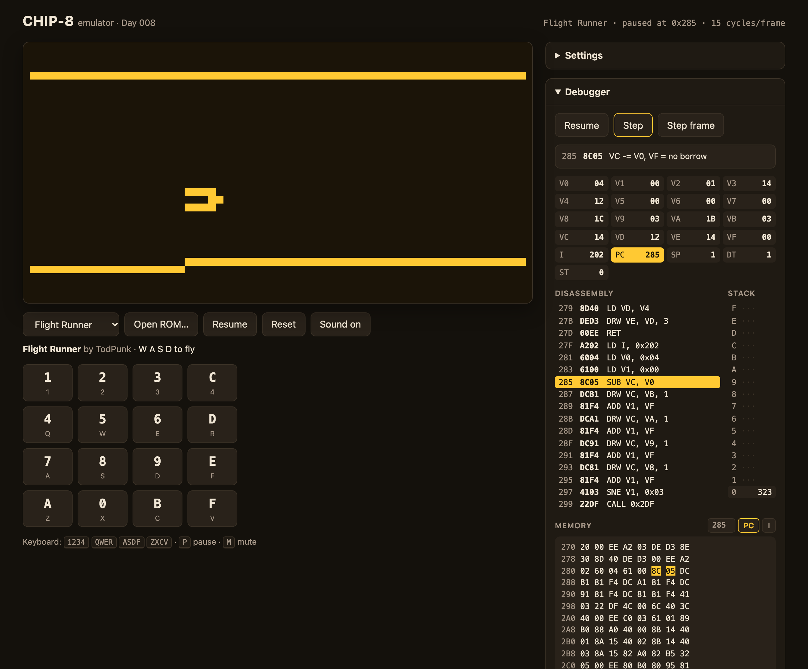
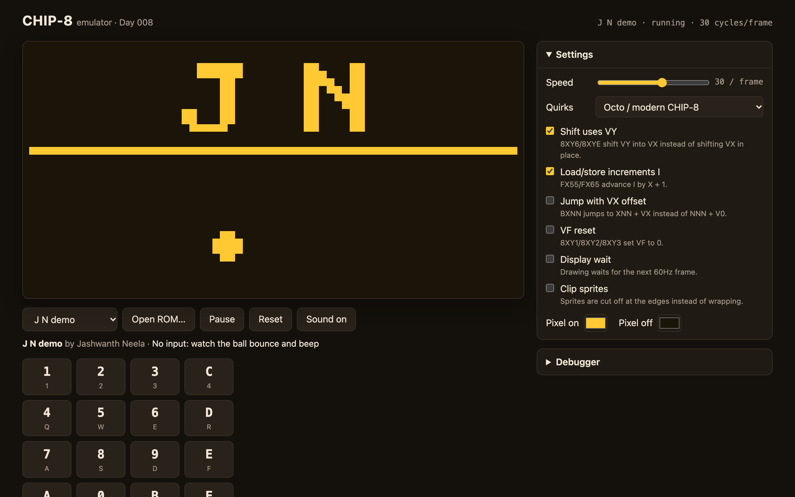

# Day 008: chip8-emu

**Date:** 2026-11-13

## What it does

A CHIP-8 emulator in TypeScript that runs in the browser. Pick a built-in ROM or open your own `.ch8` file, play with the keyboard or the on-screen keypad, and pause at any point to step through the program one instruction at a time while watching the registers, stack, disassembly and memory change.



## Why I built it

I wanted to know what actually happens between "here is a file of bytes" and "a game is on screen". CHIP-8 is the smallest real answer to that: 35 instructions, 4KB of memory, a 64x32 screen and two timers. It is small enough to build in a day and still has the parts every emulator has (a fetch/decode/execute loop, timing, input, video and sound), plus a history of interpreters that disagree with each other in small ways.

## Tech used

- TypeScript with Vite, no frameworks
- Canvas 2D (`putImageData` on a 64x32 canvas, scaled up with `image-rendering: pixelated`)
- Web Audio (one square-wave oscillator gated by a gain node)
- Pointer Events for the touch keypad
- vitest with v8 coverage, plus Playwright (headless Chromium) for the screenshots

## How to run

```bash
cd day-008-chip8-emu
npm install
npm run dev       # play locally at http://localhost:5173
npm run build     # type-check, then build the static site into dist/
npm run preview   # serve the built dist/ locally
npm test          # 329 tests, no browser needed
npm run test:cov  # same, with coverage (fails under 90% on the core)
npm run roms      # reassemble roms/*.asm into public/roms/*.ch8
```

Add `?rom=snek` to the URL to start a specific built-in ROM, and `?debug` to open the debugger on load.

## Controls

The original COSMAC VIP had a 16-key hex keypad. It maps onto the left side of the keyboard by physical position, so the grid is the same on AZERTY or Dvorak:

```
 CHIP-8 keypad        Keyboard
 ┌───┬───┬───┬───┐    ┌───┬───┬───┬───┐
 │ 1 │ 2 │ 3 │ C │    │ 1 │ 2 │ 3 │ 4 │
 ├───┼───┼───┼───┤    ├───┼───┼───┼───┤
 │ 4 │ 5 │ 6 │ D │    │ Q │ W │ E │ R │
 ├───┼───┼───┼───┤    ├───┼───┼───┼───┤
 │ 7 │ 8 │ 9 │ E │    │ A │ S │ D │ F │
 ├───┼───┼───┼───┤    ├───┼───┼───┼───┤
 │ A │ 0 │ B │ F │    │ Z │ X │ C │ V │
 └───┴───┴───┴───┘    └───┴───┴───┴───┘
```

| Key | Action |
|-----|--------|
| <kbd>P</kbd> | Pause / resume |
| <kbd>N</kbd> | Step one instruction (while paused) |
| <kbd>M</kbd> | Mute / unmute |

On a phone, use the on-screen keypad below the screen. It also lights up whichever keys are held, from any source, which helps when working out a game's controls. You can drop a `.ch8` file onto the screen to load it.

## How the emulator works

Everything that matters runs without a browser: `cpu.ts`, `display.ts`, `machine.ts`, `quirks.ts` and `disasm.ts` are plain TypeScript, and the UI only reads from them. That is why the tests don't need a DOM.

### The fetch/decode/execute cycle

`Cpu.step()` runs exactly one instruction:

```
            ┌─────────────────────────────────────────────────────┐
            │                                                     │
            ▼                                                     │
   ┌──────────────────┐   memory[PC] << 8 | memory[PC+1]          │
   │      FETCH       │   e.g. bytes D1 25  ->  opcode 0xD125     │
   └────────┬─────────┘                                           │
            │  PC += 2 (before executing, so jumps and skips      │
            │  can overwrite it)                                  │
            ▼                                                     │
   ┌──────────────────┐   split into nibbles:                     │
   │      DECODE      │     op>>12 = D   X = 1   Y = 2   N = 5    │
   │                  │     NN = 0x25    NNN = 0x125              │
   └────────┬─────────┘   switch on the top nibble, then N or NN  │
            │                                                     │
            ▼                                                     │
   ┌──────────────────┐   DXYN: draw 5 rows from I at (V1, V2),   │
   │     EXECUTE      │   XOR onto the screen, VF = collision     │
   └────────┬─────────┘                                           │
            │                                                     │
            ├── unknown opcode / stack over- or underflow:        │
            │     throw a Chip8Error, leave PC on the culprit     │
            │                                                     │
            └─────────────────────────────────────────────────────┘
```

### Timing: one frame at a time

CHIP-8 has no fixed clock speed, but its two timers and the display run at 60Hz. `Machine` keeps those separate:

```
 requestAnimationFrame (60, 120 or 144Hz, whatever the screen does)
            │  elapsed ms
            ▼
   FrameClock: acc += ms × 60; frames = floor(acc / 1000)
            │  whole 60Hz frames (capped at 4 after a background tab)
            ▼
   for each frame:
       run up to cyclesPerFrame instructions   ◄── the Speed slider
       (stop early if waiting for a key or a vblank)
       delay timer -1, sound timer -1, start a new vblank
```

So the Speed slider changes how fast games *think*, but a game's half-second pause still lasts half a second. Keeping time as milliseconds × 60 means one second is exactly 60 frames, with no drift from adding up `16.666…`.

### Display, input and sound

- **Display:** a `Uint8Array` of 64×32 pixels. `DXYN` XORs each sprite bit onto it and sets VF if any pixel turns off; that collision flag is how most games detect hits. The start position always wraps; pixels running off the edge are clipped or wrapped depending on a quirk. The canvas is repainted only when something changed.
- **Input:** 16 booleans. `EX9E` and `EXA1` check them. `FX0A` blocks until a key is pressed **and released**, which is what the original interpreter did and what most games expect.
- **Sound:** while the sound timer is above zero a 440Hz square wave plays. The gain ramps over 5ms so beeps don't click. Browsers only allow audio after a user gesture, so the AudioContext is created on your first click or key press.

### The debugger



Pause, then **Step** runs one instruction and **Step frame** finishes the current 60Hz frame. The panel shows:

- the current opcode with a plain-English explanation (`8C05: VC -= V0, VF = no borrow`)
- all registers, with the ones the last step changed highlighted
- the 16-level stack, with the return addresses in use
- disassembly around PC (click a line to inspect that address)
- a memory viewer that can follow PC or I, or jump to any address

When something goes wrong, such as an unknown opcode or a 17th nested `CALL`, the emulator stops with a message like `Stack overflow: more than 16 nested calls at 0x2A4 (opcode 22A4)`, and PC stays on that instruction so the debugger shows exactly what failed.

## Quirks explained

Different CHIP-8 interpreters disagree on a few instructions, and games were written against whichever interpreter their author had. The settings panel has a checkbox for each quirk and three presets. Built-in ROMs switch to the preset they need when you pick them.

| Quirk | When on | When off | VIP | Octo | SUPER-CHIP |
|-------|---------|----------|:---:|:----:|:----------:|
| Shift uses VY | `8XY6`/`8XYE` shift **VY** and store it in VX | shift VX in place | on | on | off |
| Load/store increments I | `FX55`/`FX65` leave I at I + X + 1 | I is unchanged | on | on | off |
| Jump with VX offset | `BXNN` jumps to XNN + **VX** | `BNNN` jumps to NNN + **V0** | off | off | on |
| VF reset | `8XY1`/`8XY2`/`8XY3` set VF to 0 | VF untouched | on | off | off |
| Display wait | `DXYN` waits for the next 60Hz frame (max 60 sprites/s) | draw immediately | on | off | off |
| Clip sprites | pixels past the edge are cut off | they wrap to the other side | on | off | on |

The default for a ROM you open yourself is the **COSMAC VIP** (1977) behaviour, the original definition of CHIP-8. Most modern homebrew, including the games bundled here, targets **Octo**. Many 1990s games need **SUPER-CHIP**. If a game looks broken (sprites smeared, scores garbled, the ball passing through walls), try another preset first.

Display wait is the one you can see. On the VIP, a loop that erases a sprite and redraws it spends a frame on each draw, so the sprite is invisible half the time and flickers. That's authentic, and it's why my demo ROM uses the Octo preset.

## Bundled ROMs



| ROM | By | Notes |
|-----|----|-------|
| J N demo | me | Draws "J N" and bounces a ball that beeps on the walls. Hand-written in [`roms/jn-demo.asm`](roms/jn-demo.asm), 123 bytes. |
| Keypad test | me | Shows the hex digit of each key you press. Useful for checking the touch keys on a phone. |
| Br8kout | SharpenedSpoon | Breakout. A / D. |
| Super Pong | offstatic | Two paddles at once. E starts, W/S and A/D move the paddles. |
| Flight Runner | TodPunk | Fly through a tunnel. WASD. |
| Snek | John Earnest | Snake in 65 bytes. WASD. |

The four games come from the [CHIP-8 Community Archive](https://github.com/JohnEarnest/chip8Archive), which releases everything under CC0. [ROMS.md](ROMS.md) lists sources, licenses, controls and SHA-256 checksums, and a test fails if that file and the bundled ROMs ever disagree. I wrote my two ROMs in assembly with a small two-pass assembler ([`tools/asm.ts`](tools/asm.ts)) that reads the same mnemonics the debugger prints.

## Tests

`npm test` runs 329 tests in under a second, all in Node:

- every opcode group, including `CXNN` with a seeded RNG so random results are reproducible
- all `8XYN` arithmetic and logic with carry, borrow and shift flags under each quirk setting, including the case where X is VF itself (the flag has to win)
- `DXYN` XOR, collision, wrapping vs clipping, and display wait limiting draws to one per frame
- BCD, timers, font addresses, load/store with and without the I increment, and `FX0A` waiting for press *and* release
- stack overflow at 17 nested calls and underflow on a bare `RET` raise errors naming the address and opcode; unknown opcodes are reported, not skipped
- timers drop by exactly 60 per second at 1, 7, 15, 100 and 1000 cycles per frame, and with irregular 1–60ms frame gaps
- disassembler mnemonics for all 35 opcodes, and an exhaustive round trip: all 65,536 16-bit words go through the disassembler and back through the assembler unchanged
- every bundled ROM runs 20 seconds of emulated play with random key presses under three seeds without an error, and the demo ROM's letters, divider and ball are checked pixel by pixel

Core coverage (cpu, quirks, display, machine, disasm) is 100% of lines and branches. `npm run test:cov` fails if it drops under 90%.

## Project layout

```
src/
  cpu.ts        memory, registers, font, stack, the 35 opcodes, errors
  quirks.ts     quirk flags and the VIP / Octo / SUPER-CHIP presets
  display.ts    64x32 framebuffer, XOR sprite drawing, RGBA conversion
  machine.ts    60Hz frame clock and cycles-per-frame scheduling
  disasm.ts     disassembler, plain-English explanations, hex dump
  input.ts      keyboard mapping and the touch keypad
  audio.ts      Web Audio beeper
  settings.ts   saved settings (localStorage, validated on load)
  debugger.ts   the debugger panel
  ui.ts         the app: run loop, canvas, controls, settings panel
  roms.ts       the built-in ROM catalog
  main.ts       entry point, ROM dropdown and URL parameters
roms/           assembly source for my ROMs
public/roms/    the bundled .ch8 files
tools/          the assembler and the ROM build script
tests/          vitest suites
docs/           screenshots
```

## What I learned

- An emulator's core is a `switch` statement. Fetch, advance PC, decode nibbles, execute fits on one screen; the time goes into timing, input and the places interpreters disagree.
- Advancing PC *before* executing makes every jump, skip and call simpler, and it means an error handler has to wind PC back by two to point at the culprit.
- The order of writes matters in `8XYN`: when X is F, the result and the flag land in the same register, and the flag has to be written last. It's an easy bug and a one-line test.
- Timers and CPU speed are separate concerns. Running N instructions per 60Hz frame and ticking the timers once per frame makes games run at the right pace at any speed setting and on 144Hz screens.
- "CHIP-8" isn't one machine. The same ROM can be correct on the VIP and broken under SUPER-CHIP. Bundling each game with the quirk preset it was written for mattered more than any single default.
- Writing the demo ROM in assembly was the best test of the emulator. Bouncing a ball needs XOR erasing, the delay timer for pacing, subroutines and skips, so a bug in any of them shows up straight away.
- An assembler and a disassembler that share syntax can test each other exhaustively. Running all 65,536 words through both took under a second.

## Ideas to extend

- SUPER-CHIP and XO-CHIP: 128x64 hi-res mode, scrolling, 16x16 sprites and XO-CHIP's colour planes and audio patterns.
- Breakpoints and watchpoints in the debugger (stop when PC reaches an address, or when memory at I changes).
- Save states: serialise memory, registers and the framebuffer to localStorage.
- Rewind: keep the last few seconds of states in a ring buffer and scrub backwards.
- Run the [Timendus CHIP-8 test suite](https://github.com/Timendus/chip8-test-suite) as a second opinion on the quirks (it's GPL-3.0, so fetch it at test time rather than bundling it).

## Author

**Jashwanth Neela** · [GitHub](https://github.com/NJashwanth)
