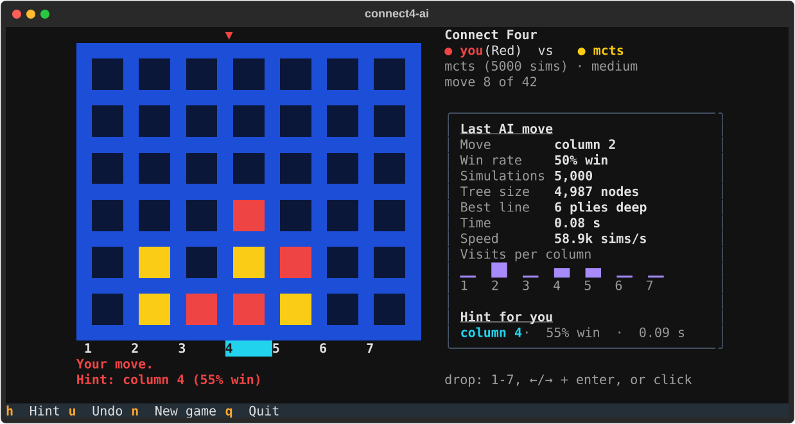
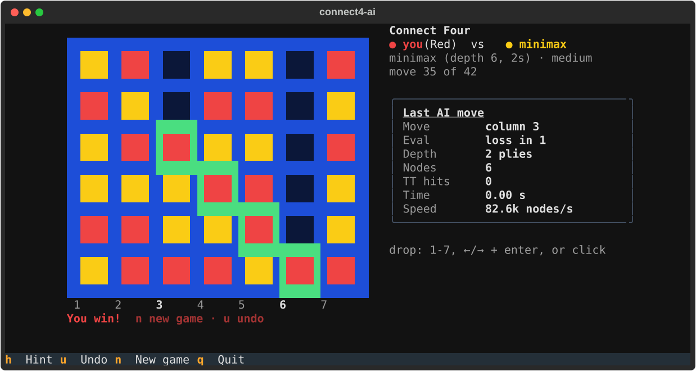

# Day 009: connect4-ai

**Date:** 2026-11-14

## What it does

A Connect Four engine in pure Python with three opponents (random, minimax with alpha-beta, and Monte Carlo Tree Search), a terminal UI to play them in, and an arena that pits them against each other and rates them with Elo. The TUI animates each drop, frames the winning four, shows what the AI was thinking (nodes or simulations, eval, depth, time), and can suggest your next move.

## Why I built it

Board game AI was "real AI" long before neural nets, and I wanted to see two very different ideas side by side on the same game. Minimax needs a hand-written sense of what a good position looks like. MCTS needs none: it plays thousands of random games and counts. Which one wins when they get a similar budget? The arena answers that with numbers instead of a hunch.

## Tech used

- Python 3.10+, no dependencies for the engine or AIs
- [Textual](https://textual.textualize.io/) for the TUI (thread workers, timers, SVG screenshots)
- pytest and pytest-cov (131 tests, 99% coverage, about 4 seconds)

## How to run

```bash
cd day-009-connect4-ai
python -m venv .venv && source .venv/bin/activate
pip install -r requirements.txt

python play.py                          # you vs minimax (medium)
python play.py --ai mcts --level hard   # pick opponent and difficulty
python play.py --ai minimax --ai-first  # let the AI open
python arena.py --games 100             # AI vs AI round-robin with Elo
python arena.py --agents minimax:easy,minimax:hard,mcts --games 30
```

In the TUI: `1`-`7` drop a piece (or `←`/`→` and `enter`, or click a column), `h` hint, `u` undo, `n` new game, `q` quit.

Tests and coverage:

```bash
pip install -r requirements-dev.txt
python -m pytest --cov --cov-fail-under=85
python tools/screenshots.py             # regenerate docs/*.svg
```

### Difficulty levels

| Level | minimax | MCTS |
|-------|---------|------|
| easy | depth 2 | 300 simulations |
| medium | depth 6 (2 s cap) | 5,000 simulations |
| hard | iterative deepening for 3 s (reaches depth 15 from the opening) | 3 s of simulations (about 135,000) |

## Files

| File | What it holds |
|------|---------------|
| `connect4/engine.py` | Bitboard `Board`: make/undo, win and draw detection, winning cells, Zobrist hash |
| `connect4/agents.py` | `Agent` interface, `SearchInfo`, random baseline, difficulty table, `make_agent` |
| `connect4/minimax.py` | Heuristic eval, plain minimax (reference), alpha-beta with TT and iterative deepening |
| `connect4/mcts.py` | UCB1 tree search with random rollouts on raw bitboards |
| `connect4/arena.py` | Round-robin schedule, Elo, standings, head to head, markdown report |
| `connect4/tui.py` | Textual app: board widget, drop animation, stats panel, hint, undo |
| `play.py`, `arena.py` | Command line entry points |
| `tools/screenshots.py` | Scripted, seeded games that save the SVG screenshots |

## The board in two integers

Each player's pieces are one Python int. Bit `col * 7 + row` is a cell, and every column gets a seventh, always-empty bit on top so shifts never wrap into the next column:

```text
col:   0  1  2  3  4  5  6
       6 13 20 27 34 41 48   <- sentinel row, always 0
       5 12 19 26 33 40 47
       4 11 18 25 32 39 46
       3 10 17 24 31 38 45
       2  9 16 23 30 37 44
       1  8 15 22 29 36 43
       0  7 14 21 28 35 42   <- bottom row
```

Four in a row is two shifts and two ANDs per direction: `m = b & (b >> d)` marks pairs, `m & (m >> 2d)` marks fours, with `d` = 1 (vertical), 7 (horizontal), 6 and 8 (the diagonals). A Zobrist hash (one random 64-bit number per cell per player, XORed in and out) is updated on every make and undo, so the transposition table never has to hash a board from scratch.

## How each AI thinks

### Minimax with alpha-beta

Minimax assumes both sides play their best. You pick the move with the highest score; the opponent replies with the move that is lowest for you. At the depth limit a heuristic scores the position: every line of four cells that only one player occupies is worth 2 (two pieces) or 5 (three pieces), and each piece in the centre column is worth 3. A real four is worth `1,000,000 - moves played`, so a faster win scores higher.

Alpha-beta gets the same answer while skipping branches that cannot change it:

```text
                         you to move (MAX)
             +-----------------+-----------------+
           col 4             col 3             col 5        searched centre first
           (MIN)             (MIN)             (MIN)
          = 3              <= 1              <= 2
        +---+---+        +---+---+         +---+---+
        5   3   7        1   x   x         2   x   x
                             ^                 ^
                     pruned: the opponent can already hold you to 1 here
                     (or 2), and you have 3 from col 4, so the rest of
                     this branch cannot matter

  best move: col 4, score 3
```

What makes it fast:

- **Centre-first ordering.** Columns are tried 4, 3, 5, 2, 6, 1, 7, so good moves come first and cut off the rest sooner.
- **Transposition table.** Many move orders reach the same position (4-5-3 and 3-5-4). Each searched position is stored by its Zobrist hash with its depth, score, whether that score is exact or a bound, and its best move, which is tried first next time.
- **Iterative deepening.** Search depth 1, then 2, then 3, until the time limit. The shallow passes fill the table with good move orders for the deeper ones, and there is always a finished answer when time runs out.
- **Cheap tactics.** If any move wins on the spot it is returned without searching, and since that is the fastest possible win, no deeper search could beat it.

On the position after `4453`, plain minimax at depth 5 visits 18,154 nodes; alpha-beta visits 1,127 with the same answer, and the transposition table halves the work again at depth 8 (15,852 to 8,492 nodes). A test checks that alpha-beta, with and without the table, returns exactly the same move and score as plain minimax on dozens of random positions.

### Monte Carlo Tree Search

MCTS has no idea what a good position looks like. It grows a tree of moves, and for every new leaf plays one completely random game to the end to see who won:

```text
        +------------------------------------------------------------+
        |                                                            |
        v                                                            |
  1. SELECT         2. EXPAND         3. ROLLOUT        4. BACKPROPAGATE
  walk down the     add one child     play random       walk back up:
  tree, at each     for a move not    moves until       every node whose
  node taking the   tried yet         someone wins      mover won gets +1
  child with the                      or the board      (+0.5 for a draw),
  best UCB1 score                     is full           every node gets a visit
        |                                                            ^
        +---------> ... ------------> ... ------------> ... ---------+

  repeat 5,000 times (or until the clock runs out), then play the most visited move


  UCB1(child) =  wins / visits   +   1.41 * sqrt( ln(parent visits) / visits )
                 \___________/       \_______________________________________/
                   exploit:                explore: grows for moves that
                   how good it             have been tried less often
                   looks so far
```

Moves that keep winning random games get visited more, and their subtrees get explored more deeply, so the tree grows unevenly toward the lines that matter. The TUI shows the visit count per column as a little bar chart: that is the AI's entire opinion of the position.

## Arena results

`python arena.py --games 100 --level medium` (full report in [`results/arena.md`](results/arena.md)):

| Rank | Agent | Budget | Elo | W | L | D | Score | Avg think / move | Avg nodes / move |
|-----:|-------|--------|----:|--:|--:|--:|------:|-----------------:|-----------------:|
| 1 | mcts | mcts (5000 sims) | 1676 | 51 | 15 | 0 | 77.3% | 61.0 ms | 5,000 |
| 2 | minimax | minimax (depth 6, 2s) | 1654 | 49 | 18 | 0 | 73.1% | 5.2 ms | 1,029 |
| 3 | random | random | 1170 | 0 | 67 | 0 | 0.0% | 0.0 ms | 1 |

Head to head (row agent's wins-losses-draws against the column agent):

| | mcts | minimax | random |
|---|---|---|---|
| **mcts** | - | 18-15-0 | 33-0-0 |
| **minimax** | 15-18-0 | - | 34-0-0 |
| **random** | 0-33-0 | 0-34-0 | - |

Both AIs won every game against random. Between them, MCTS edged minimax 18-15. MCTS also spent about 12 times as long per move (61 ms vs 5 ms), so at medium the levels are matched on difficulty, not on compute. Minimax at depth 6 is deterministic, so all the variety in those 33 games comes from the MCTS seed. The Elo ratings are updated game by game in the order played, so the gap between the two AIs (22 points) is well within noise; the gap to random is not.

## Screenshots

Mid-game against MCTS: the last AI move's stats with visits per column, and a hint (column 4, highlighted) for you.



A won game against minimax: the winning diagonal is framed in green, and the AI's last search already knew it was lost ("loss in 1").



## What I learned

- Bitboards make the rules almost free. A win check is eight shifts and eight ANDs, and the empty sentinel bit on top of each column is the whole trick that stops lines wrapping across columns.
- Score wins by the move count on the board, not by distance from the root. That number belongs to the position, so a cached score stays correct no matter which move order reached it. It is the detail that let the alpha-beta-plus-table search match plain minimax exactly in tests.
- Transposition table bounds are easy to get subtly wrong. The table can narrow the alpha-beta window before the search starts, and the result must be classified as exact, lower or upper against that narrowed window, not the original one.
- A random-rollout MCTS with no knowledge of Connect Four kept pace with a hand-tuned minimax. The heuristic is the weak point of minimax: at depth 6 it only sees what "windows of four" can describe.
- Textual's SVG screenshots draw text in whatever font the viewer has, so block characters leave gaps between lines. Drawing the board with background colours only makes the terminal and the screenshot look the same.
- Running the AI in a thread worker and handing the result back with `call_from_thread` keeps the drop animation smooth even during a 3-second search.

## Ideas to extend

- Reuse the MCTS tree between moves instead of starting fresh each turn.
- Smarter rollouts: take a winning move or block a loss when one exists, then compare against pure random.
- An opening book, or a full solver (null-window search with a bitboard move order) for perfect play.
- Rate the agents with Bradley-Terry over all games instead of order-dependent sequential Elo.
- Run arena games in parallel processes.

## Author

**Jashwanth Neela** · [GitHub](https://github.com/NJashwanth)
