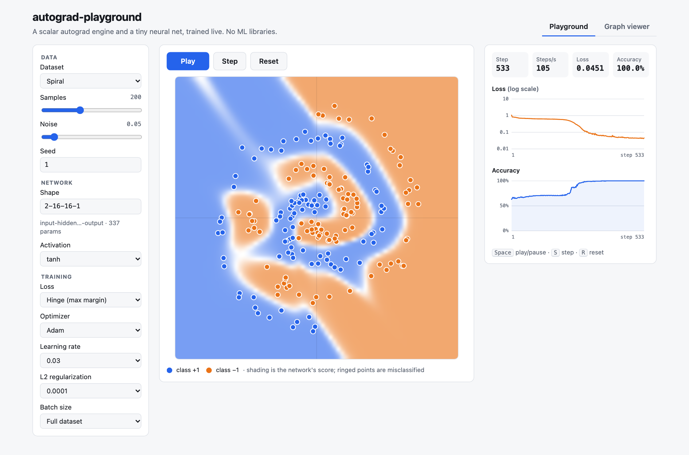
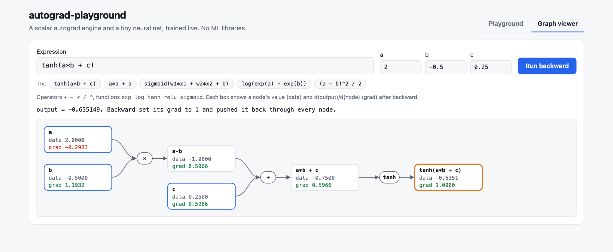
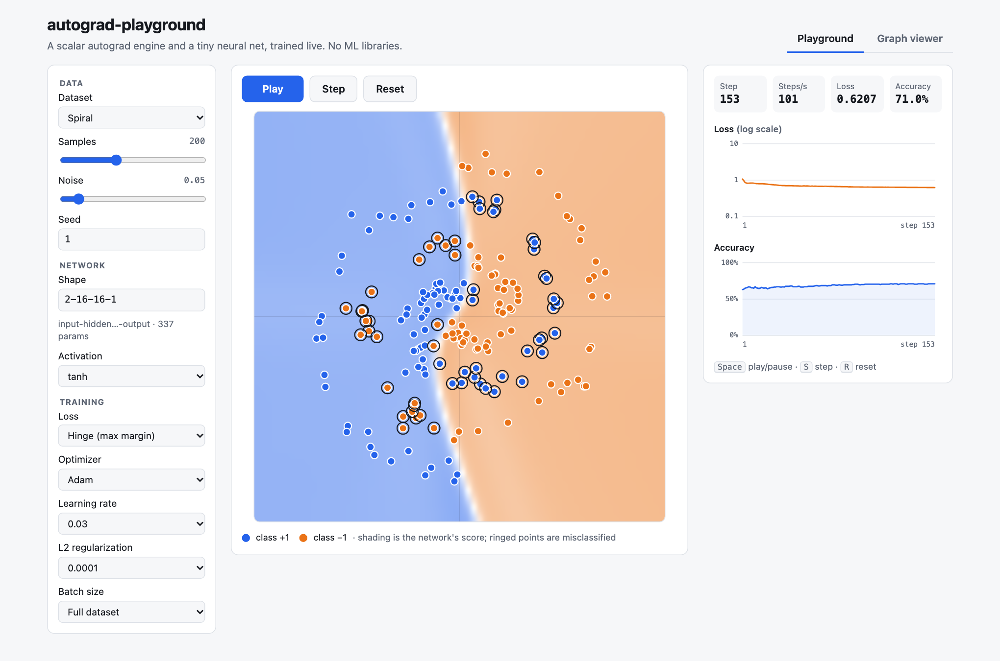

# Day 013: autograd-playground

**Date:** 2026-11-19

## What it does

A scalar autograd engine and a tiny neural net library written from scratch in TypeScript, with a browser playground for training them. Pick a dataset (two moons, circles, XOR or spiral), a network shape, an activation, a loss, an optimizer, a learning rate and L2 strength. Then press Play and watch the decision boundary bend around the data while the loss and accuracy charts update live. A second tab draws the computation graph of any small expression, such as `tanh(a*b + c)`, with the value and gradient of every node after backward.



## Why I built it

On Day 7 I trained a GPT with PyTorch, and `loss.backward()` did all the calculus for me. I wanted to know exactly what happens inside that call. The smallest honest answer is a scalar engine: every number remembers how it was made, and backward walks that record in reverse, applying the chain rule one node at a time. If that engine can train a network to separate two interleaved spirals in a browser tab, then I understand what PyTorch is doing for me.

## Tech used

- TypeScript with Vite, no frameworks and no ML libraries
- Canvas 2D for the decision boundary heatmap, inline SVG for the charts and the computation graph
- vitest with v8 coverage, plus Playwright (headless Chromium) for the screenshots

## How to run

```bash
cd day-013-autograd-playground
npm install
npm run dev         # the playground at http://localhost:5173
npm test            # 216 tests, no browser needed
npm run test:cov    # same, with coverage (fails under 90% on the core)
npm run train:all   # train every dataset in Node and print a results table
npm run build       # type-check, then build the static site into dist/
```

Open `/#graph` to go straight to the graph viewer. In the playground, <kbd>Space</kbd> plays and pauses, <kbd>S</kbd> takes one step and <kbd>R</kbd> resets.

## How backprop works

Each `Value` holds `data`, `grad`, its `parents` (the values it was computed from) and the `op` that combined them. Arithmetic builds a graph as a side effect:

```ts
const a = new Value(2), b = new Value(-0.5), c = new Value(0.25);
const out = a.mul(b).add(c).tanh();   // forward: builds 3 new nodes
out.backward();                       // backward: fills in every .grad
```

`backward()` sorts the graph topologically (inputs before the nodes that use them, each node once), sets `out.grad = 1`, and then visits the nodes in reverse order. Each node multiplies its own grad by the local derivative of its op and **adds** the result into its parents' grads. Because grads add up, a node used twice (`a*a`, or a weight shared across many samples) collects every contribution.

Here are the numbers for `tanh(a*b + c)` with a = 2, b = -0.5, c = 0.25. The graph viewer shows the same values:

```
 FORWARD (left to right): compute data

   a = 2 ─────┐
              ├─( × )──► a*b = -1 ─────┐
   b = -0.5 ──┘                        ├─( + )──► a*b + c = -0.75 ──( tanh )──► out = -0.6351
                         c = 0.25 ─────┘


 BACKWARD (right to left): grad = d(out)/d(node), using the chain rule

   out.grad      = 1                                        start: d(out)/d(out)

   tanh:  local derivative = 1 - out²  = 1 - 0.4034 = 0.5966
          (a*b + c).grad   = 0.5966 × out.grad              = 0.5966

   + :    local derivative = 1 for both inputs, so the grad passes through unchanged
          (a*b).grad       = 1 × 0.5966                     = 0.5966
          c.grad           = 1 × 0.5966                     = 0.5966

   × :    each input's local derivative is the OTHER input's data
          a.grad           = b × (a*b).grad = -0.5 × 0.5966 = -0.2983
          b.grad           = a × (a*b).grad =  2   × 0.5966 =  1.1932
```

So nudging `b` up by 0.01 should move the output by about +0.012, and nudging `a` up should move it down by about 0.003. The tests check every op this way: they compare the engine's grads against finite differences, `(f(x+h) − f(x−h)) / 2h`.



The local derivatives the engine uses:

| Op | Forward | Backward (for upstream grad g) |
|----|---------|--------------------------------|
| `a + b`, `a - b` | | a += g, b += g (or −g) |
| `a * b` | | a += b·g, b += a·g |
| `a / b` | refuses b = 0 | a += g/b, b −= a/b²·g |
| `a ^ k` (constant) | refuses 0^negative and negative^fraction | a += k·a^(k−1)·g |
| `a ^ b` (variable) | needs a > 0 | a += b·a^(b−1)·g, b += out·ln(a)·g |
| `neg`, `exp`, `log` | log refuses ≤ 0 | −g, out·g, g/a |
| `tanh`, `sigmoid`, `relu` | | (1−out²)·g, out(1−out)·g, g if out > 0 |
| `sum` (n-ary) | | every input += g |

Two implementation details matter for speed. The topological sort is iterative and marks visited nodes with a per-sort counter instead of building a `Set`, so a 100,000-node chain doesn't overflow the stack. And `backward` is a single `switch` on `op` instead of a closure per node, which keeps each node small. One full-batch step on 200 points with a 2-16-16-1 network builds 75,881 nodes, and the playground runs about 100 of those steps per second.

## The neural net

- **`Neuron`**: `act(w·x + b)`, where `w·x + b` is one n-ary `sum` node. Weights start uniform with variance 1/fan-in (2/fan-in for ReLU), and biases start at 0.
- **`Layer`, `MLP`**: configurable hidden activation (tanh, ReLU, sigmoid, linear), and a linear output that gives a raw score. A 2-16-16-1 net has 337 parameters. `predict()` runs the same maths on plain numbers without building a graph, which keeps the 72×72 heatmap and the accuracy check cheap.
- **Losses** (labels are ±1, and a score above 0 means +1): MSE, hinge `mean(relu(1 − y·s))`, and binary cross-entropy on logits, written as `relu(z) − t·z + log(1 + exp(−|z|))` so it can't overflow.
- **L2**: `λ·Σp²` added to the loss.
- **Optimizers**: SGD (with momentum 0.9 in the playground) and Adam with bias correction. The tests check one or two steps of each against numbers worked out by hand.

## Training results

`npm run train:all` trains each dataset with the playground defaults: 2-16-16-1, tanh, hinge loss, Adam at lr 0.03, L2 0.0001, 200 samples, full batch, seed 1. Each run stops once accuracy has held at 100% for 50 steps.

| Dataset | Noise | Steps to 100% | Final accuracy | Final loss | Steps run | Time (Node) |
|---------|------:|--------------:|---------------:|-----------:|----------:|------------:|
| moons | 0.1 | 68 | 100.0% | 0.0160 | 118 | 0.8s |
| circles | 0.1 | 73 | 100.0% | 0.0164 | 123 | 0.6s |
| xor | 0.1 | 138 | 100.0% | 0.0190 | 188 | 0.9s |
| spiral | 0.05 | 381 | 100.0% | 0.0484 | 431 | 2.0s |
| spiral | 0.1 | not reached | 99.0% | 0.1120 | 3000 | 28.7s |

"Steps to 100%" is where the final unbroken run at 100% began. Spiral first touches 100% at step 337, then dips once before it holds. At noise 0.1, a couple of spiral points land inside the other arm and the network stops at 99%. That's why the playground switches the spiral to noise 0.05 by default.

Spiral is the interesting one. For the first ~220 steps the network finds only a near-straight cut and stays at about 70%. Then the boundary starts to curl, and accuracy climbs from 72% at step 220 to 100% by step 337:



Everything is seeded (dataset, weights and minibatch order), so the browser and Node produce identical runs. The screenshots above show step 153 at loss 0.6207 / 71.0% and step 533 at loss 0.0451 / 100%, and `Trainer` in Node gives exactly those numbers.

## Tests

`npm test` runs 216 tests in Node in about 4 seconds:

- **engine**: finite-difference gradient checks for every op (both pow forms, relu on both sides of the kink, n-ary sum) and for long chained expressions, plus micrograd's reference expression with PyTorch's values. Reused nodes (`a*a`, `a+a`, a node feeding two branches, the same node listed twice in a sum) accumulate correctly. Topological order visits every node once with inputs first. `backward()` on an array is rejected with a clear message. Division by zero, `log(0)`, `log(-2)`, a bad pow domain and overflow to Infinity each raise an `AutogradError` that names the problem.
- **nn and optim**: parameter counts for several shapes (337 for 2-16-16-1), zeroGrad clears every grad, `predict()` matches `forward()`, losses match hand computations and finite differences, BCE stays finite at ±800, and SGD, momentum and Adam match hand-computed values for one and two steps.
- **datasets and training**: same seed gives the same data and a different seed gives different data, shapes and ±1 labels are right with balanced classes, the noise-free geometry is checked (circle radii, XOR signs, spiral angles, moon arcs), and invalid options are rejected. XOR reaches 100% within a fixed seeded budget, with a 2-8-1 Adam net and with the classic 4-point XOR on a 2-4-1 SGD net. Every loss and optimizer combination learns circles, and minibatches are seeded and sampled without repeats.
- **graph viewer parser**: precedence, left and right associativity, `-a^2 = -(a^2)`, parentheses, functions and number formats. It rejects 15 kinds of bad input with a position, round-trips through the formatter, and checks layout invariants (no overlaps, edges flow left to right) and the SVG contents.

Coverage on the core (engine, rng, nn, optim, datasets, train, graphview) is 100% of lines and branches. `npm run test:cov` fails if it drops under 90%. `ui.ts` is DOM glue, which I checked by hand and with Playwright.

## Project layout

```
src/
  engine.ts      Value: data, grad, parents, op; the ops, topo sort and backward
  nn.ts          Neuron, Layer, MLP, activations, MSE / hinge / BCE losses, L2, accuracy
  optim.ts       SGD (with momentum) and Adam
  rng.ts         mulberry32 and Gaussian sampling, so everything is seeded
  datasets.ts    moons, circles, XOR and spiral generators
  train.ts       Trainer (one step = forward, loss, zeroGrad, backward, update), shape parsing
  graphview.ts   expression parser, Value graph builder, layout and SVG renderer
  ui.ts          the playground and graph viewer in the browser
  main.ts        entry point
tools/
  train-all.ts   trains all four datasets and prints the results table
tests/           vitest suites
docs/            screenshots
```

## What I learned

- Backprop is mostly bookkeeping. The chain rule per op is one line each. The real work is the order (reverse topological, so a node's grad is complete before it is passed on) and using `+=` instead of `=`. With `=`, `a*a` would get a grad of `a` instead of `2a`, and a weight shared across 200 samples would learn from only the last one.
- A scalar engine is slow, but not uselessly so: about 76,000 nodes per step and about 100 steps per second in a browser tab. A single n-ary `sum` node per neuron, instead of a chain of adds, keeps the graph shallow and saves one node per input.
- A second, graph-free `predict()` path is worth having. The heatmap evaluates the network 5,184 times per frame, which would be far too slow if every evaluation built a graph.
- Writing BCE naively as `-log(sigmoid(z))` fails as soon as the network gets confident. The stable form needs `|z|`, which I built from two ReLUs.
- Grad-checking against finite differences catches mistakes that reading the code doesn't. I used it as the oracle for every op, every loss and a whole MLP.
- My first screenshot script read the step counter and the loss at different moments while training was still running, which made the browser look like it disagreed with Node. Pausing first showed they match to every digit.

## Ideas to extend

- Tensor ops (a vectorised `Value` over Float64Arrays) to see how much of PyTorch's speed comes from batching rather than from C++.
- Extra input features (x², y², xy, sin) like the TensorFlow Playground, to show how good features make the spiral easy for a tiny net.
- Multi-class softmax with cross-entropy, and a 3-arm spiral.
- Show the gradients of the first layer as arrows on the heatmap, or animate one backward pass node by node in the graph viewer.
- Move training into a Web Worker so the UI stays smooth with bigger networks.

## Author

**Jashwanth Neela** · [GitHub](https://github.com/NJashwanth)
