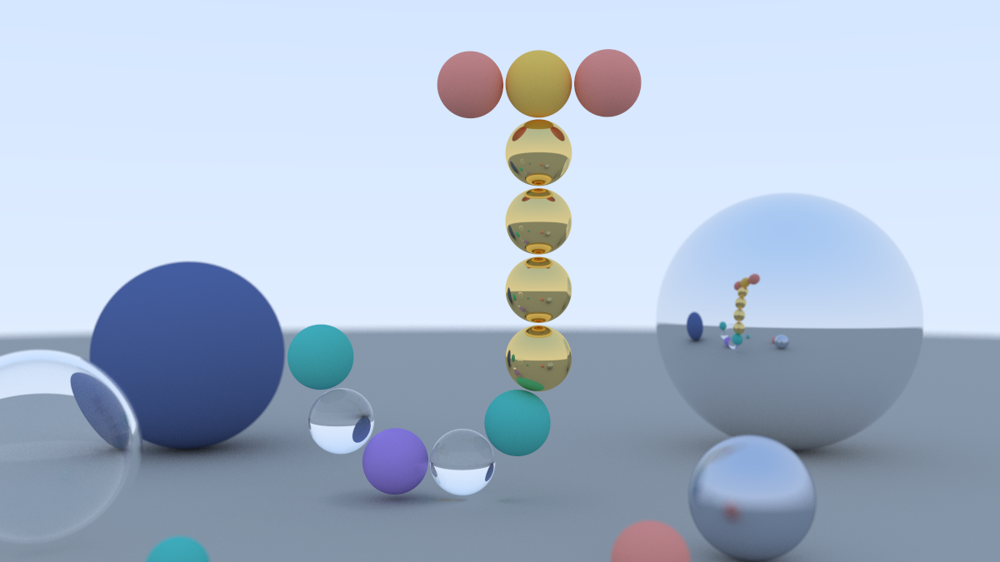
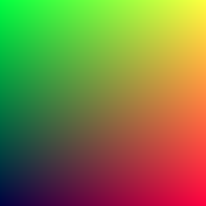
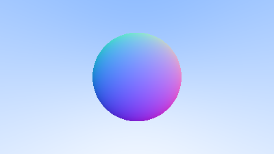
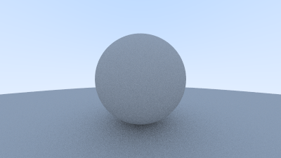
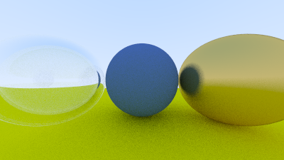
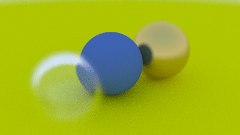
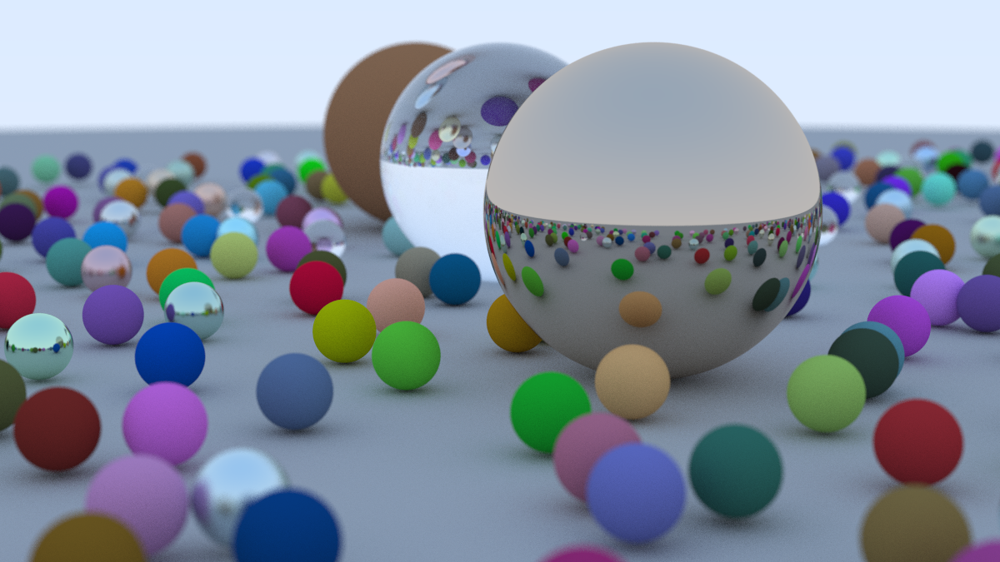

# Day 014: ray-tracer

**Date:** 2026-11-20

## What it does

A path tracer in Rust, written from scratch following the ideas in "Ray Tracing in One Weekend". It reads a TOML scene (camera, materials, spheres) and renders it to a PNG: matte, fuzzy metal and glass spheres under a sky, with antialiasing, depth of field, a BVH to skip most intersection tests, and every core rendering rows in parallel.



```
$ cargo run --release -- render scenes/random.toml --width 1200 --spp 200 --seed 42
Rendered 1200x675 at 200 spp, max depth 50 (482 objects, BVH on, 8 threads) in 16.76s
Wrote renders/random.png
```

## Why I built it

I've seen ray-traced images forever and never written one. I wanted to know how little code it takes to get from "a ray and a sphere" to an image that looks like a photo, and where the realism actually comes from. (Mostly: random bounces, averaged lots of times.) I also wanted a CPU-bound project to try Rust's data-parallel side, and to see how much a BVH really buys you.

## How a ray tracer works

Follow light backwards. Instead of simulating light leaving the sun, shoot rays out of the camera, one or more per pixel, and ask "what light could have arrived along this ray?"

```
  sky: the only light source
  ~~~~~~~~~~~~~~~~~~~~~~~~~~~~~~~~~~~~~~~~~~~~~~~~~~~~~~~~~~~~
                                                    /  4
  camera     | pixel            .---.              /
             |                 /     \            /
   O---------+----- 1 ------->| metal |          /
             |                 \     /          /
             |                  '---' \        /
             |                       2 \      /  3
             |                          \    /
             |                           \  /
  ________________________________________\/________________ ground (matte)
```

1. **Camera ray.** A ray leaves the camera through a random point inside one pixel. With an aperture, it starts from a random point on the lens instead of a pinhole, aimed at the same spot on the focus plane, so only things at the focus distance stay sharp.
2. **Hit.** The nearest sphere is found by solving a quadratic for `t` along the ray (through the BVH, so most spheres are never tested). The metal reflects it about the surface normal and keeps 90% of the light: the running color is multiplied by `0.9`.
3. **Bounce.** The ray hits the ground. A matte surface scatters it in a random direction around the normal and keeps 50%: multiply by `0.5`.
4. **Escape.** The ray misses everything and reaches the sky, which is the light source: a white-to-blue gradient. This sample's color is `sky × 0.9 × 0.5`. A ray that's absorbed, or still bouncing after `max_depth` bounces, contributes black.

Do that 100 to 500 times per pixel, average, apply gamma (a square root), and write the bytes. Shadows, color bleeding, soft reflections and caustic-ish glass all come out of those four steps without being programmed in. Glass picks between reflecting and refracting at random, weighted by Schlick's approximation, and always reflects when Snell's law has no solution (total internal reflection).

## Progression

One small render per stage, each made with the code as it was at that commit:

| 1. PNG output | 2. First sphere | 3. Antialiasing + gamma |
|:-:|:-:|:-:|
|  |  |  |
| Red grows to the right, green upward. Proves the PNG writer. | One ray per pixel, colored by surface normal over a sky gradient. | 100 jittered samples per pixel, gray diffuse bounces, gamma 2. |

| 4. Materials | 5. Depth of field | Final: random field |
|:-:|:-:|:-:|
|  |  |  |
| Hollow glass (a 1/1.5 "air" sphere inside a 1.5 one), matte, fuzzy gold. Fixed 90° camera. | Positionable camera, 25° field of view, aperture 0.6 focused on the blue sphere. | `random.toml` at 1200 px, 200 spp, seed 42: 482 spheres. |

The BVH, rayon and TOML stages don't change any pixels. The image after the BVH commit was byte-identical to the one before it, and the parallel renderer matches the single-threaded one byte for byte.

## BVH vs no BVH

Same scenes, same settings, 8 threads on an Apple Silicon Mac. The output is byte-identical either way (checked with `cmp`):

| scene | objects | settings | BVH | no BVH (`--no-bvh`) | speedup |
|-------|--------:|----------|----:|--------------------:|--------:|
| random.toml | 482 | 1200x675, 200 spp | 16.76 s | 108.83 s | **6.5x** |
| random.toml | 482 | 600x338, 50 spp (median of 3) | 1.12 s | 6.46 s | 5.8x |
| showcase.toml | 20 | 1200x675, 500 spp | 15.60 s | 14.72 s | 0.94x |
| showcase.toml | 20 | 600x338, 50 spp (median of 3) | 0.39 s | 0.45 s | 1.15x |

With 482 spheres, a ray that would test all 482 now tests a handful of boxes and a few spheres. With 20 it's a wash: walking the tree costs about as much as testing 20 spheres directly. The random field gains "only" 6.5x partly because of the ground: a sphere of radius 1000 has a bounding box that covers the whole scene, so every node above it is entered by every ray.

## Tech used

- Rust 2024, no graphics libraries: vectors, intersection, materials and the BVH are all hand-written
- [rayon](https://crates.io/crates/rayon) for parallel rows, [indicatif](https://crates.io/crates/indicatif) for the progress bar
- [rand](https://crates.io/crates/rand) with a fixed-seed PCG generator ([rand_pcg](https://crates.io/crates/rand_pcg))
- [png](https://crates.io/crates/png) for output, [serde](https://serde.rs) + [toml](https://crates.io/crates/toml) for scenes, [clap](https://crates.io/crates/clap) for the CLI
- cargo-llvm-cov for coverage

```
src/
  vec3.rs      Vec3 with operator overloading; random-in-sphere/unit-vector/disk helpers
  rng.rs       seeded PCG generator and per-row streams
  ray.rs       origin + t * direction
  camera.rs    look-from/look-at, vertical FOV, aspect ratio, aperture, focus distance
  hittable.rs  Hittable trait, HitRecord with front-face normals, HittableList
  sphere.rs    ray-sphere intersection
  material.rs  Lambertian, Metal (fuzz), Dielectric (Snell, TIR, Schlick)
  bvh.rs       AABB slab test and a flat BVH split on the longest axis
  scene.rs     TOML scene format, validation, random sphere field
  render.rs    path tracing loop, antialiasing, gamma, rayon rows, PNG writing
  main.rs      the `render` command
scenes/        showcase.toml (the "J"), random.toml (the classic field)
```

## How to run

```bash
cd day-014-ray-tracer
cargo run --release -- render scenes/showcase.toml --out renders/showcase.png
cargo run --release -- render scenes/random.toml --width 1200 --spp 200 --seed 42
cargo run --release -- render scenes/showcase.toml --no-bvh   # compare speed
```

Flags override the scene's `[render]` table: `--width`, `--spp`, `--max-depth`, `--seed`, `--out` (default `renders/<scene>.png`), `--no-bvh`, and `-q` to hide the progress bar. `random.toml`'s field has no seed of its own, so `--seed` changes both the noise and where the small spheres go.

A scene file looks like this. Only `camera.look_from`, `look_at` and `vfov` are required; `focus_dist` defaults to the distance to `look_at`:

```toml
[camera]
look_from = [13, 2, 3]
look_at = [0, 0, 0]
vfov = 20
aperture = 0.1
focus_dist = 10

[render]
width = 600
samples_per_pixel = 100
max_depth = 50
seed = 42

[materials.glass]
type = "dielectric"   # or "lambertian" (albedo) or "metal" (albedo, fuzz)
ior = 1.5

[[objects]]
type = "sphere"
center = [0, 1, 0]
radius = 1
material = "glass"

[random_field]        # optional: one small random sphere per grid cell
extent = 11
radius = 0.2
```

Mistakes get specific errors:

```
error: invalid scene file: TOML parse error at line 8, column 8
  |
8 | type = "chrome"
  |        ^^^^^^^^
unknown variant `chrome`, expected one of `lambertian`, `metal`, `dielectric`

error: invalid scene: object 1 uses unknown material "gold" (defined: chrome, glass)
```

Tests and coverage:

```bash
cargo test
cargo llvm-cov --summary-only
```

### Tests

118 tests: 109 unit tests, 6 that run the real binary, and 3 that load the bundled scenes. Coverage with cargo-llvm-cov is 99.86% of lines and 99.78% of regions. Key checks:

- Vec3 operators, dot, cross, unit vectors and near-zero; the random helpers stay inside the sphere, on the unit sphere, and flat in the disk.
- Ray-sphere: head-on hit, miss, an exactly tangent hit, a ray starting inside (far wall, flipped normal), and exclusive `t_min`/`t_max` bounds.
- Reflection and refraction against hand-computed vectors (air into glass at 45° gives `(0.4714, -0.8819, 0)`); total internal reflection switches on between 41.80° and 41.82°, around the critical angle of 41.81°; Schlick gives 0.04 head on and 1.0 at grazing.
- AABB slab tests including parallel rays and an origin exactly on a face, and the BVH returns exactly the same closest hit as brute force for 10,000 seeded rays (each checked with an infinite and a finite `t_max`) over 10 seeded scenes of 1 to 500 spheres.
- The same seed gives a byte-identical 32x18 PNG, on 1, 2 or 8 threads, and with or without the BVH.
- Camera: vertical FOV sets the angle to the top edge, aperture origins stay on the lens, and every ray through one pixel meets at the same point on the focus plane.
- Scene parsing: full scenes load, and missing fields, typos, unknown material types, unknown material names and bad values all get clear messages.

## What I learned

- A tangent ray found a real edge case. At the exact top of a sphere, `direction · normal` is exactly 0, and my `< 0` check called that an inside hit and flipped the normal. A ray starting inside a sphere always leaves with a positive dot product, so 0 counts as outside now.
- Determinism with threads is about how you use randomness, not about locks. Each row gets its own generator seeded from `(seed, row)`, so it doesn't matter which thread renders it or when. The parallel output is byte-identical to the sequential one, which made "did rayon break anything?" a one-line test.
- The BVH equivalence test against brute force was the most valuable test in the project, and comparing whole hit records with `==` (not just "hit or not") is what makes it strict. Same for comparing whole PNG files byte for byte across stages.
- `f64::max` quietly ignores NaN. The slab test gets `0 × ∞ = NaN` when a ray runs parallel to a box face and starts exactly on it, and `max`/`min` drop the NaN, which turns out to be the right answer.
- Speed came from the BVH and threads, not micro-tuning: 6.5x from the BVH on 482 spheres, and 5.0x from 8 threads over 1 (5.21 s to 1.05 s for `random.toml` at 600 px and 50 spp, via `RAYON_NUM_THREADS=1`). But a BVH doesn't help a 20-sphere scene, and one giant ground sphere weakens it for every ray.
- A hollow glass ball is just a second sphere inside the first with index `1/1.5`: from inside the glass, the ray sees "air" as a material with a lower index. No special case needed.
- Making a letter out of spheres is harder than it sounds. My first "J" had a glass top bar that vanished against the sky and a hook that read as clutter. Matte color on the bar and a wider five-sphere hook fixed it.

## Ideas to extend

- Emissive materials and an area light, so scenes can be lit by something other than the sky.
- Triangles and a mesh loader. The `Hittable` trait and AABB are ready for more shapes.
- Surface-area-heuristic BVH splits, and keep giant objects like the ground out of the tree.
- Importance sampling toward lights, to cut noise at the same sample count.
- Textures (checker, image, Perlin noise) and motion blur.
- A tile-based renderer that shows the image filling in live.

## Author

**Jashwanth Neela** · [GitHub](https://github.com/NJashwanth)
