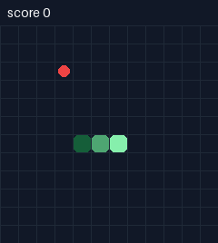
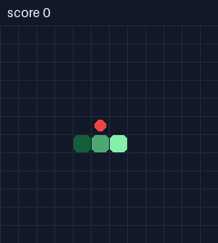
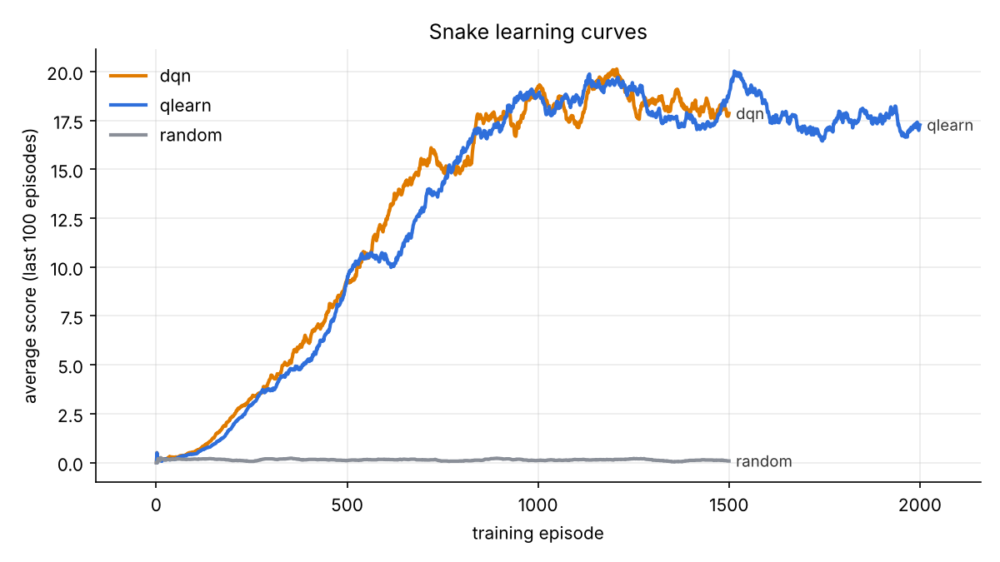

# Day 015: snake-rl

**Date:** 2026-11-21

## What it does

A Snake environment with a gym-style API (`reset`, `step`, `render`) and three agents that play it: a random baseline, tabular Q-learning, and a small DQN in PyTorch on CPU. You can train them, compare them greedily on the same seeded boards, and replay an episode as an animated GIF or live in the terminal.

Both learners go from a random score of 0.12 to about 20 apples per game on a 12x12 grid.

| Random agent | Trained DQN |
|---|---|
|  |  |

## Results

Greedy evaluation over 200 episodes, every agent on the same 200 seeded boards (`python compare.py --episodes 200`):

| Agent | Mean | Median | Max |
|---|---:|---:|---:|
| random | 0.12 | 0.0 | 2 |
| qlearn | 20.41 | 19.5 | 47 |
| dqn | 20.86 | 20.0 | 40 |

Learning curves (average score over the last 100 training episodes, seed 42):



What the numbers say:

- Both learners beat random by a wide margin and end up level. The 0.45 gap between DQN and Q-learning is well inside the episode-to-episode spread (the max scores are 40 and 47), so I would not call a winner.
- With the compact 11-feature state the agent only sees the three cells next to its head and a rough food direction. It cannot see its own body further away, so it eventually coils itself into a trap. That plateau at about 20 looks like a limit of the state, not of the learner. The `--state grid` option gives the DQN the whole board for the next experiment.
- Reward shaping did not help the tabular agent in one run: with `--no-shaping` (seed 42, 2000 episodes) it scored a mean of 23.0 and median of 22 over the same 200 boards, against 20.4 with shaping. One seed is not evidence, but it is a reminder that "obviously helpful" shaping can bias the policy toward greedy approaches that trap the snake.
- Training time on CPU: Q-learning 2000 episodes in about 7 seconds, DQN 1500 episodes in about 3 minutes.

## Why I built it

I had read about Q-learning and DQN but never watched the same problem solved by both. Snake is small enough to run in seconds and rich enough to show where a lookup table and a neural network behave the same, and where they would not.

## How Q-learning and DQN work

Both are reinforcement learning: an agent acts in an environment, gets a reward, and tries to maximise the total reward over time.

```
          action a
   +-----------------------+
   |                       v
+-------+            +-------------+
| Agent |            | Environment |
|  (Q)  |            |   (Snake)   |
+-------+            +-------------+
   ^                       |
   +-----------------------+
     state s', reward r, done
```

Each step: the agent sees state `s`, picks an action `a` (epsilon-greedy: a random move with probability epsilon, otherwise the move with the highest Q), the environment returns the new state `s'` and a reward `r` (+10 apple, -10 death, +/-0.1 for moving toward or away from the apple), and the agent learns from that one transition `(s, a, r, s')`.

`Q(s, a)` is the expected total future reward of taking `a` in `s` and playing well afterwards. It must satisfy the Bellman equation:

```
Q(s, a) = r + gamma * max over a' of Q(s', a')        (0 if s' is terminal)
```

**Tabular Q-learning** keeps `Q` as a table with one row per state (the 11 binary features pack into one of 2048 rows) and nudges one cell toward the Bellman target after every step:

```
Q(s, a)  <-  Q(s, a) + alpha * ( r + gamma * max Q(s', .) - Q(s, a) )
                                 \_____________________________/
                                      TD error (target - guess)
```

**DQN** replaces the table with a small network `Q(s, .; theta)` (11 -> 64 -> 64 -> 4), which can handle states too numerous to tabulate. Training a network on its own moving targets is unstable, so it adds two tricks:

```
 transitions --> [ replay buffer ] --random batch--> loss = Huber( Q_online(s, a),
                                                                    r + gamma * (1-done) * max Q_target(s', .) )
 Adam step updates Q_online every step;  Q_target <- copy of Q_online every N steps
```

- **Replay buffer**: store recent transitions and train on random batches, so consecutive (highly correlated) frames do not dominate.
- **Target network**: a frozen copy of the online net computes the target, synced every 200 gradient steps, so the target does not chase every update.
- **Huber loss**: quadratic for small errors, linear for large ones, so a -10 death does not blow up gradients.

## Tech used

- Python, PyTorch (CPU), NumPy
- Pillow for the GIF renderer, rich for the live terminal view, matplotlib for the learning curves
- pytest and pytest-cov

## How to run

```bash
cd day-015-snake-rl
pip install -r requirements-dev.txt     # CPU torch via the extra index

python train.py --agent qlearn --episodes 2000
python train.py --agent dqn --episodes 1500 --seed 42
python compare.py --episodes 200        # random vs qlearn vs dqn
python watch.py --agent dqn --gif docs/dqn.gif
python watch.py --agent dqn --terminal  # live in the terminal

python -m pytest --cov                  # 83 tests, 99% coverage, a few seconds
```

Useful flags: `--size 8` for another grid, `--no-shaping` to turn off the toward-food reward, `--state grid` for the full-board DQN input, `--tag name` to keep several runs side by side, `--hp lr=0.0005` to override a hyperparameter, and `--best-of 20` on `watch.py` to record the best of 20 episodes.

Training writes a per-episode CSV (score, avg100, epsilon, loss) to `runs/` and the best and last checkpoints to `checkpoints/`; both are git-ignored. `train.py` redraws `docs/learning_curves.png` from every CSV in `runs/`, so all agents land on one chart.

## Layout

```
env.py            Snake environment, 11-feature and grid states, reward shaping
agents/           random_agent.py, qlearn.py, dqn.py
replay.py         ring-buffer experience replay
train.py          training loop, CSV logs, checkpoints, learning-curve plot
compare.py        greedy evaluation table
render.py         GIF renderer (Pillow) and terminal view (rich)
watch.py          CLI for replays
tests/            pytest suite
```

## What I learned

- The state design mattered more than the algorithm. Q-learning and DQN landed on the same score because they see the same 11 numbers.
- Making the env seedable end to end (board, food, agent, torch) turned "did it learn?" into a test: a 200-episode seeded DQN run on a 6x6 board beats random by more than 2 points, every time.
- A starvation limit (no food for `size * size` steps ends the episode with the death penalty) is needed, otherwise a policy can loop forever and never be punished.
- Pillow merges identical consecutive GIF frames, so the frame count in a GIF test only holds if each frame differs; the death frame is tinted for that reason.

## Ideas to extend

- Train the DQN on the full grid state (`--state grid`), ideally with a small CNN, to see whether seeing the whole body breaks the plateau.
- Double DQN and prioritised replay.
- Run several seeds per setting and report mean with a confidence interval, which would settle the shaping question.
- Add a "tail reachability" feature so the agent can tell when a move seals it into a dead end.

## Author

**Jashwanth Neela** · [GitHub](https://github.com/NJashwanth)
