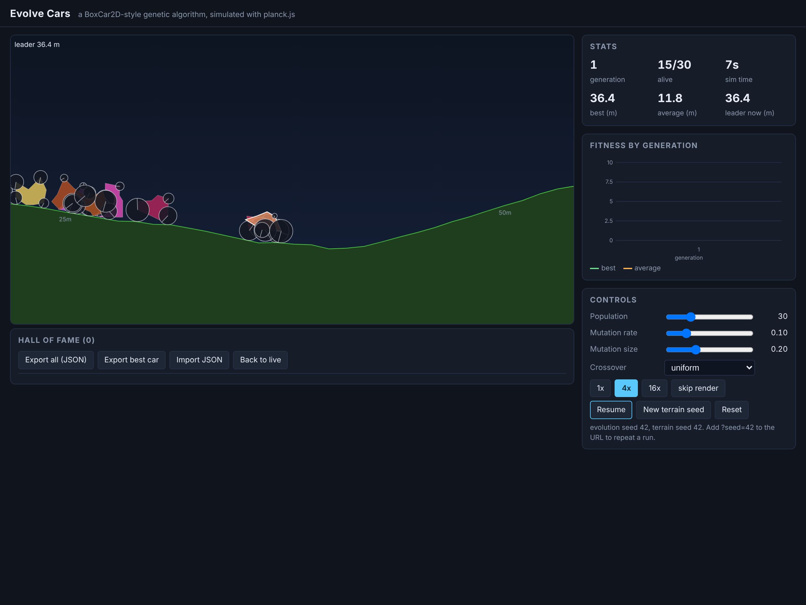
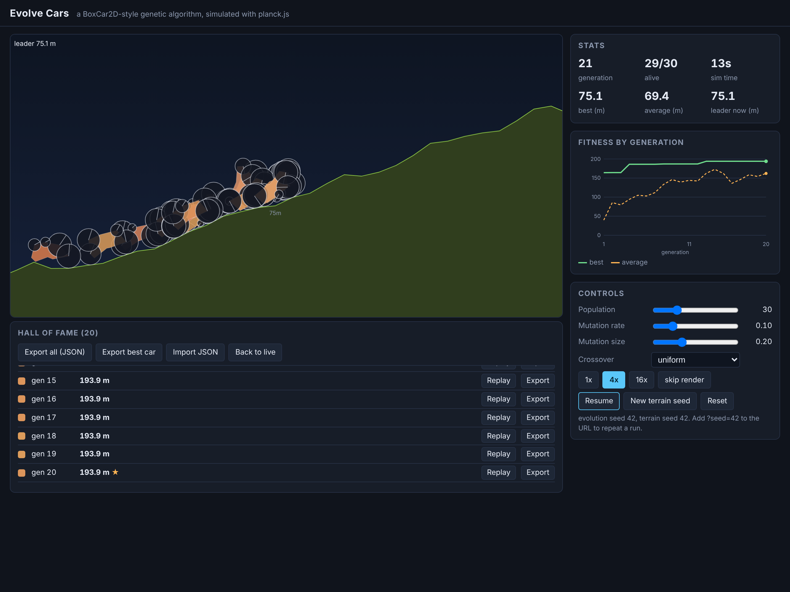
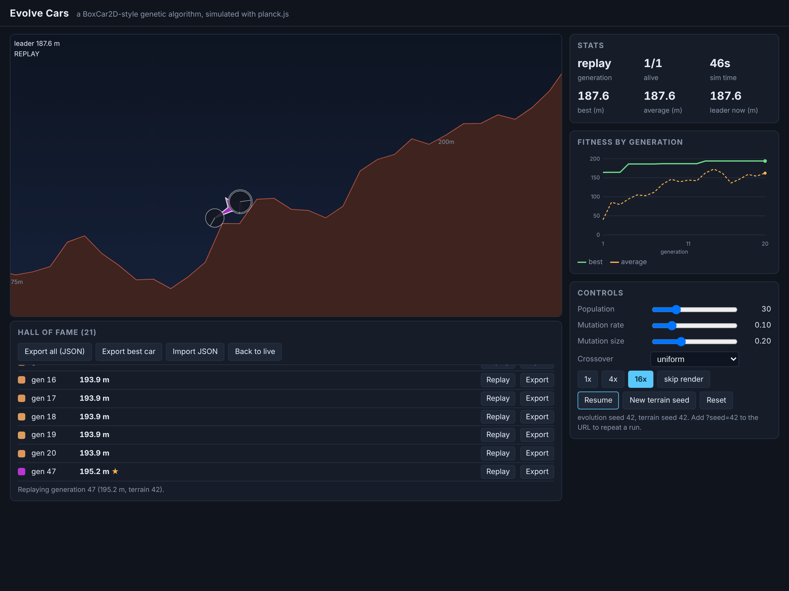

# Day 017: evolve-cars

**Date:** 2026-11-23

## What it does

A BoxCar2D-style genetic algorithm: random cars (8 chassis vertices, 2 to 4 wheels) are dropped on a seeded, ever steeper track, simulated with planck.js, and bred by how far they get. It runs live in the browser with a leader-following camera, stats, a fitness chart and a hall of fame, or headless in Node with the exact same code.



## Why I built it

I wanted to watch selection pressure work. Nothing here is trained by gradients: shapes that happen to roll further get to reproduce, and after a few dozen generations the average car goes from a pile of tumbling polygons to something that drives. It also forces the unglamorous parts to be right: a genome that always builds a valid body, and a simulation that is deterministic enough to test.

## Tech used

- TypeScript, Vite (vanilla TS, no framework)
- planck.js for 2D physics (fixed 1/60 s timestep)
- Canvas for the scene, inline SVG for the fitness chart (no chart library)
- vitest with v8 coverage, `tsx` for the headless CLI
- Playwright (headless Chromium) for the README screenshots

## How to run

```bash
npm install
npm run dev                                    # browser UI at http://localhost:5173
npm run evolve -- --generations 50 --seed 42   # headless run in Node
npm run evolve -- --help                       # all options
npm test                                       # 90 tests
npm run test:cov                               # same, plus coverage thresholds (85%)
```

`?seed=42` in the browser URL repeats a run. `--export best.json` on the headless command writes the best genome, which the browser can import.

## Modules

| File | Job |
|------|-----|
| `src/rng.ts` | Seeded mulberry32 RNG, gaussian samples, seed derivation |
| `src/genome.ts` | Genome type, bounds, clamping, random genomes, gene derived colors |
| `src/terrain.ts` | Seeded track that gets steeper and rougher with distance |
| `src/physics.ts` | Builds the planck world and a car body from a genome |
| `src/sim.ts` | Fixed timestep simulation, fitness, stall and flip death rules |
| `src/ga.ts` | Tournament selection, crossover, mutation, elitism, `Evolution` driver |
| `src/hof.ts` | Hall of fame and JSON export/import with clear errors |
| `src/headless.ts` | Node CLI around the same `Evolution` class |
| `src/chart.ts` | Fitness chart as an SVG string |
| `src/ui.ts` | Canvas, camera, stats panel, controls, hall of fame panel |

### The genome

- 8 chassis vertices, each an angle and a radius. Vertex `i` is confined to its own 45 degree sector, so vertices are always in angular order and the chassis (a fan of 8 triangles from the centre) is always a valid shape.
- 2 to 4 wheels, each with an attachment vertex, a radius and a density. Motor torque scales with wheel mass.
- One chassis density.
- `clampGenome` forces every value into range (NaN included), so any genome builds a valid car. Colors come from the genes (hue from shape and wheel count, lightness from chassis density).

### Terrain and death rules

The track is flat for 14 m, then the slope limit, uphill bias and bump size all ramp up over the next 160 m and stay at maximum. Fitness is the furthest x reached past the spawn point. A car dies when it makes less than 0.5 m of new progress for 3 s (stall), when it is upside down and slower than 0.4 m/s for 1.5 s (flip), when it reaches the end of the track, or at a 90 s cap. Dead bodies are frozen in place so they cost nothing but stay visible.

## How the genetic algorithm works

One generation cycle:

```
                +--------------------------------------------+
                |  population of N genomes (generation g)    |
                +----------------------+---------------------+
                                       |
                                       v
        +--------------------------------------------------------------+
        | SIMULATE  all N cars on the same terrain, fixed 1/60 s step   |
        |           fitness = max distance, cars die on stall / flip    |
        +----------------------+---------------------------------------+
                               |
                               v
        +--------------------------------------------------------------+
        | RECORD    best / average / worst, best car -> hall of fame   |
        +----------------------+---------------------------------------+
                               |
                               v
        +--------------------------------------------------------------+
        | ELITISM   copy the top K genomes unchanged into generation g+1|
        +----------------------+---------------------------------------+
                               |
                               v      repeat until N children exist
        +--------------------------------------------------------------+
        | SELECT    two parents, each the fittest of k random picks     |
        | CROSSOVER uniform or single-point on a 30 gene vector         |
        |           (or copy one parent with prob 1 - crossoverRate)    |
        | MUTATE    each gene with prob rate: += gaussian(0, size*range)|
        | CLAMP     force every gene back into its valid range          |
        +----------------------+---------------------------------------+
                               |
                               v
                +--------------------------------------------+
                |  population of N genomes (generation g+1)  |
                +--------------------------------------------+
```

- **Tournament selection** (size 3 by default) picks the fittest of a few random genomes. Bigger tournaments push harder.
- **Crossover** works on a flat 30 gene vector (density, 16 vertex genes, wheel count, 4 wheel slots of 3 genes). Uniform picks each gene from a random parent; single-point takes a prefix from one parent and the rest from the other. A wheel slot one parent does not have falls back to the other parent, and a wheel that grows from a mutated count copies its neighbour on the opposite side.
- **Mutation** adds Gaussian noise scaled to each gene's range, then clamps.
- **Elitism** keeps the top K (default 2) so the best car is never lost to bad luck in breeding.

## Results

A headless 50 generation run, `npm run evolve -- --generations 50 --seed 42` (population 30, uniform crossover, mutation rate 0.10, size 0.20, 2 elites, 306 s on one core). Best and average distance in metres:

| Generation | Best | Average | Worst |
|-----------:|-----:|--------:|------:|
| 1 | 164.2 | 40.3 | 0.0 |
| 10 | 186.3 | 124.6 | 5.1 |
| 20 | 186.9 | 164.7 | 2.9 |
| 30 | 194.6 | 175.9 | 1.2 |
| 40 | 194.8 | 166.4 | 1.5 |
| 50 | 195.2 | 183.3 | 105.4 |

Best overall: 195.2 m in generation 47. The best genome is saved in [`docs/best-car.json`](docs/best-car.json).

The average more than quadruples (40 to 183 m) and the worst car goes from not moving to 105 m, but the best only gains about 19%. Random search already finds a decent car in a population of 30 on this seed, and after about generation 30 the best sits at the steep, bumpy stretch near 195 m. Evolution here is mostly lifting the whole population up to the leader, not inventing a much better leader.



The best car imported from JSON and replayed from the hall of fame, deep in the hardest stretch of the track (187.6 m of its 195.2 m run):



Regenerate the screenshots with `npm run dev` in one terminal and `node tools/screenshots.mjs docs/best-car.json` in another.

## What I learned

- A tuned difficulty curve matters more than any GA setting. My first terrain let random cars run 380 m and the 45 s time cap, not the terrain, decided fitness, so nothing could evolve. I had to steepen it until random cars stall around 130 to 160 m.
- A progress check has to compare against the last counted position, not the last step. Comparing per step against a 0.5 m threshold never fired and every car "stalled" at 3 s.
- Determinism is per population, not per genome. The same car re-simulated beside different neighbours can land a metre or so differently, because planck's solver order depends on what else is in the world. Same seed and config still give identical runs, and that is what the tests pin down.
- Laying each vertex in its own angular sector removes a whole class of invalid shapes without any repair code.

## Ideas to extend

- Evaluate each genome in its own world, or on several terrains, to remove the neighbour noise and reward robust cars.
- Evolve motor speed and torque, and add suspension springs.
- Island populations with occasional migration, or novelty search, to get past the plateau near 195 m.
- A rolling terrain that gets re-seeded every few generations so cars cannot overfit one track.

## Author

**Jashwanth Neela** · [GitHub](https://github.com/NJashwanth)
