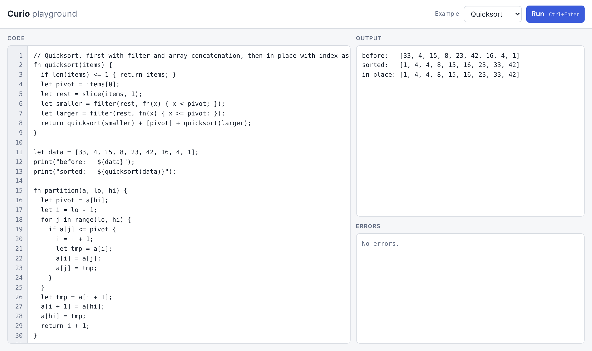

# Day 018: curio-lang

**Date:** 2026-11-24

## What it does

Curio is a small dynamic programming language written in TypeScript. It has closures, arrays, maps, string interpolation, a standard library, and error messages that show the source line with a caret and a stack trace. You can run files, use a REPL that remembers state, or try it in a browser playground.

```
let makeCounter = fn() {
  let count = 0;
  return fn() { count = count + 1; return count; };
};
let next = makeCounter();
next(); next();
print("count is ${next()}");          // count is 3
```



## Why I built it

I use languages every day without knowing what happens between typing `let x = 1;` and getting a result. I wanted to find out how much code it takes to make a language that feels real: errors that point at the mistake, closures that capture variables, recursion that fails politely instead of crashing. The answer was about 2,300 lines of TypeScript.

## Tech used

- TypeScript (strict), no runtime dependencies. The core runs in Node and in the browser unchanged.
- Hand-written lexer, Pratt parser and tree-walking interpreter
- Vite for the playground, `tsx` to run the CLI directly
- Vitest with v8 coverage (379 tests, 99% statement coverage on the core modules)
- Playwright (headless) for the screenshot

## How to run

```bash
cd day-018-curio-lang
npm install

npx tsx src/cli.ts examples/fib.curio     # run a file
npx tsx src/cli.ts                        # REPL
npx tsx src/cli.ts -e 'print(6 * 7);'     # run a snippet
npm run dev                               # playground at http://localhost:5173

npm test                                  # all tests
npm run test:cov                          # tests plus coverage (fails under 90%)
npm run build                             # typecheck and build the playground
```

Exit codes: 0 ok, 64 bad usage, 65 syntax error, 66 file not found, 70 runtime error.

## How an interpreter works

Every step turns the program into a shape that is easier to work with than the one before. Here is one line of Curio going through all of them (the token and tree output is real, produced by the project's own `lex` and `dumpAst`):

```
 source text    let area = 3 * 4 + 1;
                    |
                    |  LEXER: group characters into tokens, remember line:col
                    v
 tokens         let(1:1) Ident area(1:5) =(1:10) Number 3(1:12) *(1:14)
                Number 4(1:16) +(1:18) Number 1(1:20) ;(1:21) EOF
                    |
                    |  PARSER (Pratt): use operator precedence to build a tree
                    v
 AST            Program
                  Let area
                    Binary +
                      Binary *
                        Number 3
                        Number 4
                      Number 1
                    |
                    |  INTERPRETER: walk the tree, children first
                    v
 evaluation     3 * 4      -> 12
                12 + 1     -> 13
                define "area" = 13 in the current environment
```

- **Lexer** (`src/lexer.ts`). Reads characters and produces tokens with their line and column. It handles escapes, `${...}` interpolation (by lexing the embedded expression into its own token list), and comments. Bad input becomes an error token plus a diagnostic, so lexing never stops at the first problem.
- **Parser** (`src/parser.ts`). A Pratt parser gives each operator a binding power. `3 * 4 + 1` becomes `(3 * 4) + 1` because `*` binds tighter than `+`, and `a = b = c` becomes `a = (b = c)` because assignment is right associative. When a statement is malformed, the parser records the error, skips to a safe point (after a `;`, or before a keyword like `let`), and keeps going, so one run reports several errors.
- **Interpreter** (`src/interpreter.ts`). Evaluates the tree. Variables live in a chain of environments (`src/environment.ts`), one per block and per call. A function value keeps a pointer to the environment where it was created, which is all a closure is.

The pieces fit together like this:

| File | Job |
|------|-----|
| `src/token.ts` | token types, keywords, `describeToken` |
| `src/lexer.ts` | source text to tokens |
| `src/ast.ts` | node types, plus `dumpAst` and `toSexpr` for tests and debugging |
| `src/parser.ts` | tokens to AST, with error recovery |
| `src/environment.ts` | lexical scopes |
| `src/values.ts` | runtime values, truthiness, equality, printing |
| `src/interpreter.ts` | evaluates the AST, call stack, depth limit |
| `src/stdlib.ts` | built-in functions |
| `src/errors.ts` | diagnostics, runtime errors, caret and stack trace formatting |
| `src/repl.ts` | REPL logic (no terminal code, so it is testable) |
| `src/cli.ts` | command line entry point |
| `src/playground.ts` | browser UI |

## Language reference

### Values and truthiness

| Type | Examples | `type()` |
|------|----------|----------|
| number | `42`, `3.14`, `1e3` | `"number"` |
| string | `"hi"`, `'hi'`, `"a\n${x}"` | `"string"` |
| bool | `true`, `false` | `"bool"` |
| nil | `nil` | `"nil"` |
| array | `[1, "two", [3]]` | `"array"` |
| map | `{"a": 1, b: 2}` (a bare name is a string key) | `"map"` |
| function | `fn(x) { x + 1; }` | `"function"` |

Falsy values are `nil`, `false`, `0` and `""`. Everything else is truthy, including empty arrays and maps. `and` and `or` short circuit and return the deciding operand, so `name or "anonymous"` works. `==` compares arrays and maps by value and never converts types (`1 == "1"` is false). Map keys may be strings, numbers or booleans.

### Syntax

```
// line comment            /* block comment */
let x = 1;                 // declare (redeclaring in the same scope is allowed)
x = x + 1;                 // assign (an expression, so a = b = 0 works)
a[0] = 9;  m["k"] = 1;     // index assignment; negative indexes count from the end

if cond { ... } else if other { ... } else { ... }      // parentheses are optional
while cond { ... }
for item in collection { ... }     // arrays, strings (characters), maps (keys), range(...)
break;  continue;

let add = fn(a, b) { return a + b; };
fn add(a, b) { a + b; }            // declaration form, same thing
```

- Operators from low to high precedence: assignment, `or`, `and`, `== !=`, `< <= > >=`, `+ -`, `* / %`, unary `- !`, then calls `f(x)` and indexes `a[i]`.
- `+` adds numbers, joins strings (converting the other side with `str`), and concatenates arrays. Division and modulo by zero are errors.
- A semicolon ends a statement. It may be left off before a `}` and at the end of input.
- A block or function body evaluates to its last expression, so `fn(x) { x * x; }` returns the square. `return` exits early.
- A statement that starts with `{` is a block, unless it starts with `key:`, in which case it is a map. Wrap in parentheses when in doubt.
- Strings can interpolate any expression: `"total: ${price * qty}"`. Escapes: `\n \t \r \0 \\ \" \' \$`.

### Safety

Calls nest at most 400 deep. Past that you get `Maximum call depth of 400 exceeded. Is there a recursive function without a base case?` with a stack trace, instead of a crash. A JavaScript stack overflow from some other deep structure is also turned into a normal Curio error. The playground adds a 5,000,000 step limit so an endless loop cannot freeze the tab.

### Standard library

| Function | Description |
|----------|-------------|
| `print(...)` | print values separated by spaces, then a newline |
| `len(x)` | length of a string, array or map |
| `push(arr, v)` | append in place, returns the array |
| `pop(arr)` | remove and return the last element (error if empty) |
| `keys(map)` / `values(map)` | arrays of keys / values, in insertion order |
| `range(n)`, `range(a, b)`, `range(a, b, step)` | array of whole numbers (`b` is exclusive) |
| `map(xs, f)` | new array of `f(x)`; works on arrays, strings, map keys |
| `filter(xs, f)` | elements where `f(x)` is truthy |
| `reduce(xs, f, init)` | fold with `f(acc, x)`; `init` is optional |
| `str(v)` / `num(s)` / `type(v)` | convert to text / parse a number (error if invalid) / type name |
| `clock()` | seconds since the epoch as a float |

Callbacks may also ask for the index: `map(xs, fn(x, i) { ... })`. A few extras make the examples practical: `has(x, v)`, `join`, `split`, `sort(xs, cmp?)`, `slice`, `upper`, `lower`, `floor`, `abs`, `sqrt`, `min`, `max`.

### Error messages

Syntax errors are collected and reported together, each with a caret under the bad token:

```
error: Expected expression, found ';'
  --> two-errors.curio:3:19
  |
3 |   total = total + ;
  |                   ^

error: Expected ')' after arguments, found ';'
  --> two-errors.curio:5:21
  |
5 | print("total", total;
  |                     ^

2 syntax errors found.
```

Runtime errors show the failing line and a stack trace with function names and line numbers, innermost call first:

```
runtime error: Division by zero
  --> calc.curio:2:12
  |
2 |   return a / b;
  |            ^

Stack trace (most recent call first):
  at divide (calc.curio:2)
  at compute (calc.curio:5)
  at <main> (calc.curio:9)
```

### REPL

Multi-line input continues automatically while a statement is unfinished, state is kept between lines, and expression results are echoed:

```
curio> let makeCounter = fn() {
  ...>   let count = 0;
  ...>   return fn() { count = count + 1; return count; };
  ...> };
curio> let next = makeCounter();
curio> next()
1
curio> next()
2
curio> let other = makeCounter();
curio> other()
1
curio> next()
3
curio> count
runtime error: Undefined variable 'count'
```

`count` is private to the closure, so the REPL correctly cannot see it. Commands: `.help`, `.reset`, `.exit`.

## Example programs

All of these live in `examples/`. Each has a `.out` file with its expected output, and `tests/golden.test.ts` runs every one and compares.

### fizzbuzz.curio

```
// FizzBuzz for 1 to 20.
for i in range(1, 21) {
  if i % 15 == 0 {
    print("FizzBuzz");
  } else if i % 3 == 0 {
    print("Fizz");
  } else if i % 5 == 0 {
    print("Buzz");
  } else {
    print(i);
  }
}
```

Output: the numbers 1 to 20 with `Fizz`, `Buzz` and `FizzBuzz` in the usual places, one per line:

```
1
2
Fizz
4
Buzz
Fizz
7
8
Fizz
Buzz
11
Fizz
13
14
FizzBuzz
16
17
Fizz
19
Buzz
```

### fib.curio

```
// Fibonacci two ways: plain recursion, then recursion with a map as a cache.
let fib = fn(n) {
  if n < 2 { return n; }
  return fib(n - 1) + fib(n - 2);
};

for i in range(10) {
  print("fib(${i}) = ${fib(i)}");
}
print("fib(20) = ${fib(20)}");

let memo = {};
let fastFib = fn(n) {
  if n < 2 { return n; }
  if has(memo, n) { return memo[n]; }
  let result = fastFib(n - 1) + fastFib(n - 2);
  memo[n] = result;
  return result;
};
print("fastFib(50) = ${fastFib(50)}");
print("cached ${len(memo)} results");
```

Output:

```
fib(0) = 0
fib(1) = 1
fib(2) = 1
fib(3) = 2
fib(4) = 3
fib(5) = 5
fib(6) = 8
fib(7) = 13
fib(8) = 21
fib(9) = 34
fib(20) = 6765
fastFib(50) = 12586269025
cached 49 results
```

### closures.curio

```
// A closure remembers the variables around the place it was created.
let makeCounter = fn() {
  let count = 0;
  return fn() { count = count + 1; return count; };
};

let next = makeCounter();
next(); next();
print("count is ${next()}");

// Each counter has its own private state.
let a = makeCounter();
let b = makeCounter();
a(); a();
print("a = ${a()}, b = ${b()}");

// Closures can be built by other functions.
let adder = fn(n) { return fn(x) { return x + n; }; };
let add5 = adder(5);
let add100 = adder(100);
print(add5(1), add100(1));

// Higher-order functions with anonymous functions.
let nums = [1, 2, 3, 4, 5];
print(filter(map(nums, fn(x) { x * x; }), fn(x) { x > 5; }));
print(reduce(nums, fn(sum, x) { sum + x; }, 0));
```

Output:

```
count is 3
a = 3, b = 1
6 101
[9, 16, 25]
15
```

### quicksort.curio

```
// Quicksort, first with filter and array concatenation, then in place with index assignment.
fn quicksort(items) {
  if len(items) <= 1 { return items; }
  let pivot = items[0];
  let rest = slice(items, 1);
  let smaller = filter(rest, fn(x) { x < pivot; });
  let larger = filter(rest, fn(x) { x >= pivot; });
  return quicksort(smaller) + [pivot] + quicksort(larger);
}

let data = [33, 4, 15, 8, 23, 42, 16, 4, 1];
print("before:   ${data}");
print("sorted:   ${quicksort(data)}");

fn partition(a, lo, hi) {
  let pivot = a[hi];
  let i = lo - 1;
  for j in range(lo, hi) {
    if a[j] <= pivot {
      i = i + 1;
      let tmp = a[i];
      a[i] = a[j];
      a[j] = tmp;
    }
  }
  let tmp = a[i + 1];
  a[i + 1] = a[hi];
  a[hi] = tmp;
  return i + 1;
}

fn sortInPlace(a, lo, hi) {
  if lo < hi {
    let p = partition(a, lo, hi);
    sortInPlace(a, lo, p - 1);
    sortInPlace(a, p + 1, hi);
  }
}

sortInPlace(data, 0, len(data) - 1);
print("in place: ${data}");
```

Output:

```
before:   [33, 4, 15, 8, 23, 42, 16, 4, 1]
sorted:   [1, 4, 4, 8, 15, 16, 23, 33, 42]
in place: [1, 4, 4, 8, 15, 16, 23, 33, 42]
```

### wordcount.curio

```
// Count words with a map, then list them by frequency (ties alphabetical).
let text = "the quick brown fox jumps over the lazy dog the fox";
let counts = {};

for word in split(lower(text), " ") {
  if has(counts, word) {
    counts[word] = counts[word] + 1;
  } else {
    counts[word] = 1;
  }
}

let words = sort(keys(counts), fn(a, b) {
  if counts[a] != counts[b] { return counts[b] - counts[a]; }
  if a < b { return -1; }
  return 1;
});

for w in words {
  print("${w}: ${counts[w]}");
}
print("${len(words)} distinct words");
```

Output:

```
the: 3
fox: 2
brown: 1
dog: 1
jumps: 1
lazy: 1
over: 1
quick: 1
8 distinct words
```

### primes.curio

```
// Sieve of Eratosthenes: primes up to 50.
let limit = 50;
let isPrime = map(range(limit + 1), fn(i) { i >= 2; });

for n in range(2, limit + 1) {
  if isPrime[n] {
    for multiple in range(n * n, limit + 1, n) {
      isPrime[multiple] = false;
    }
  }
}

let primes = filter(range(limit + 1), fn(i) { isPrime[i]; });
print("primes up to ${limit}: ${primes}");
print("count: ${len(primes)}, sum: ${reduce(primes, fn(a, b) { a + b; }, 0)}");
```

Output:

```
primes up to 50: [2, 3, 5, 7, 11, 13, 17, 19, 23, 29, 31, 37, 41, 43, 47]
count: 15, sum: 328
```

### maps.curio

```
// Maps hold key/value pairs; arrays of maps make small records.
let people = [
  {name: "Ada", age: 36, tags: ["math", "code"]},
  {name: "Alan", age: 41, tags: ["logic"]},
  {name: "Grace", age: 85, tags: ["compilers", "navy"]},
];

for p in people {
  print("${p["name"]} (${p["age"]}) likes ${join(p["tags"], " and ")}");
}

let ages = map(people, fn(p) { p["age"]; });
print("average age: ${reduce(ages, fn(a, b) { a + b; }, 0) / len(ages)}");

let byName = {};
for p in people { byName[p["name"]] = p; }
print(keys(byName));
byName["Ada"]["age"] = 37;
print(people[0]["age"]);
print(has(byName, "Linus"), type(byName), len(byName));
```

Output:

```
Ada (36) likes math and code
Alan (41) likes logic
Grace (85) likes compilers and navy
average age: 54
["Ada", "Alan", "Grace"]
37
false map 3
```

## Tests

```
npm run test:cov
  Test Files  10 passed
       Tests  379 passed
  Statements  99.04%   Branches  98.18%   Functions  98.9%   Lines  99.38%
```

Covered: every token type, interpolation, escapes, unterminated strings and unknown characters with positions; precedence and associativity tables; AST snapshots for every statement type; several syntax errors recovered in one pass; arithmetic, truthiness, scoping and shadowing, closures, recursion, break and continue; arrays and maps including out-of-range and missing-key errors; every standard library function; line numbers and stack traces in runtime errors; the call depth limit; REPL sessions; the CLI; and golden tests for each example. Coverage is measured on the core modules (everything except the browser glue in `playground.ts`). Tests and coverage run locally; there is no CI.

## What I learned

- A Pratt parser is tiny. One loop and a table of binding powers replaced a whole ladder of precedence functions.
- Good error recovery is mostly about knowing where to resume. Skipping to the next `;` or statement keyword, and skipping a whole `{ ... }` block when the error was in its header, removed almost all the follow-on errors.
- A closure is just a function plus a pointer to the environment it was created in. Once environments are a linked list, closures come for free.
- Stack traces need very little machinery: a stack of (function name, call line), and each error walks it from the top.
- JavaScript runs out of stack sooner than you expect when you recurse through a tree walker (roughly 700 to 1,300 Curio calls here), so the explicit depth limit has to sit well below that.
- Small decisions have knock-on effects: letting a statement start with `{` be either a block or a map needed a one-token lookahead rule.

## Ideas to extend

- Static resolution of variables (compute scope depth once) to speed up lookups
- A bytecode compiler and VM, then compare timings with the tree walker
- Pattern matching, `+=`, and a `.` property syntax for maps
- Run the playground interpreter in a Web Worker so a long program can be cancelled
- Syntax highlighting in the editor

## Author

**Jashwanth Neela** · [GitHub](https://github.com/NJashwanth)
