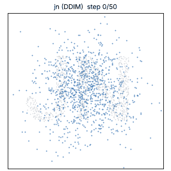
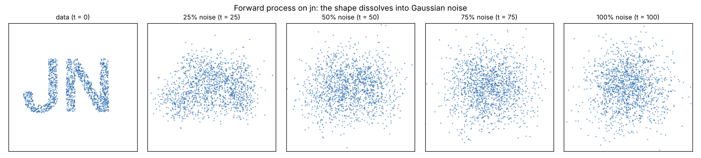
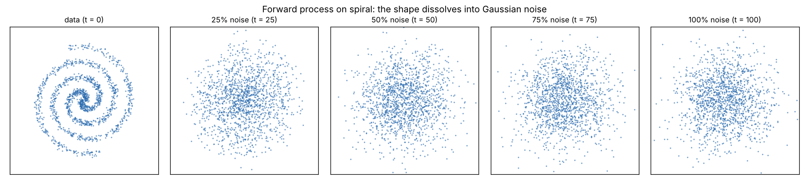
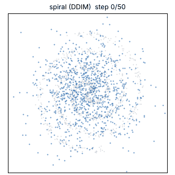
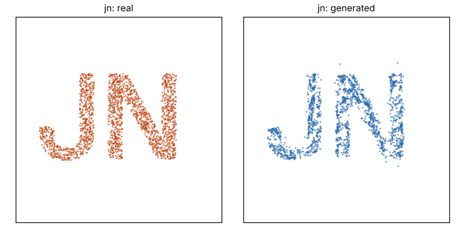
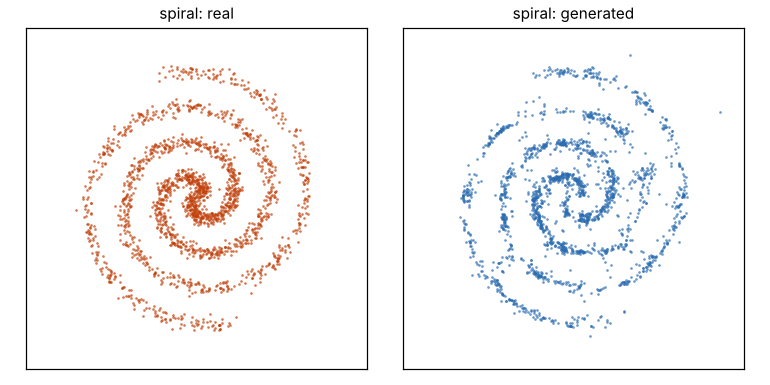
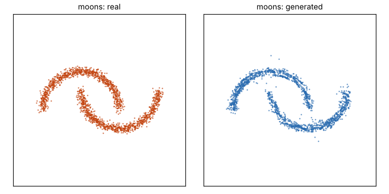
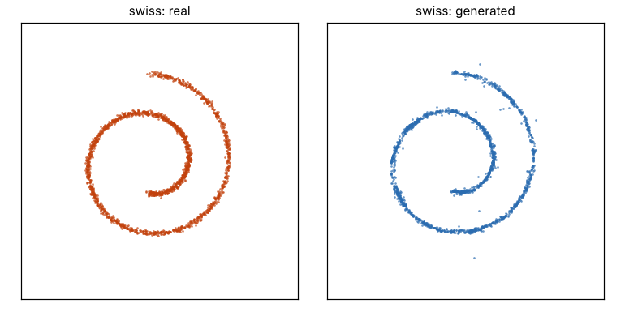
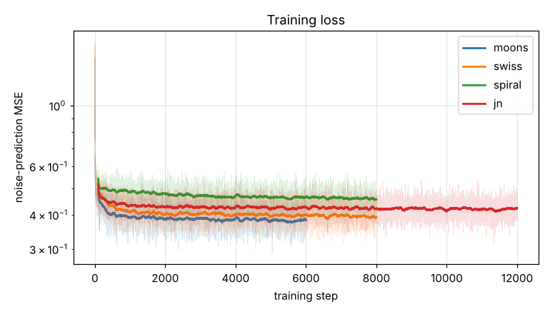

# Day 019: tiny-diffusion

**Date:** 2026-11-26

## What it does

A DDPM diffusion model written from scratch in PyTorch (CPU only) that learns to generate 2D point clouds: two moons, a swiss roll, a two-arm spiral, and the letters "JN" rendered with Pillow. Train it in under a minute, then watch noise turn into the shape with DDPM (100 steps) or DDIM (50 steps).



## Why I built it

Diffusion models sit behind most image generators, but the maths is easy to hide behind a huge U-Net. In 2D you can see every step: the shape, the noise, the learned denoiser. I wanted to implement the whole pipeline (schedules, closed-form noising, noise-prediction loss, EMA, ancestral and DDIM sampling) small enough to read in one sitting and measure honestly.

## How diffusion works

The forward process is fixed: it slowly adds Gaussian noise to a data point until nothing is left but noise. The model learns the reverse.

```
forward (no learning, closed form):   q(x_t | x_0) = N( sqrt(abar_t) x_0 , (1 - abar_t) I )

  x_0 ---> x_1 ---> x_2 ---> ... ---> x_(T-1) ---> x_T
  data     a bit    more              almost        pure
  "JN"     noisy    noisy             noise         N(0, I)
   |                                                  |
   |   x_t = sqrt(abar_t) * x_0 + sqrt(1 - abar_t) * eps,   eps ~ N(0, I)
   v
  train: pick random t, build x_t in one shot, ask the network for eps
         loss = || eps - eps_theta(x_t, t) ||^2


reverse (learned, one network call per step):

  x_T ---> x_(T-1) ---> ... ---> x_2 ---> x_1 ---> x_0
  noise    denoise      ...      denoise   denoise   sample
  N(0,I)   x_(t-1) = 1/sqrt(alpha_t) * ( x_t - beta_t / sqrt(1 - abar_t) * eps_theta(x_t, t) ) + sigma_t * z

  DDIM skips steps (T=100 -> 50 calls) and drops the fresh noise z (eta = 0),
  so the same starting noise always lands on the same point.
```

Key ideas in the code:

- `schedule.py`: linear and cosine betas, with `alphas`, `alpha_bars` and the posterior variance precomputed. `q_sample` jumps straight to any `x_t`, and a test checks it matches `t` one-step noisings in mean and variance.
- `model.py`: an MLP denoiser (4 hidden layers, 256 wide) with a sinusoidal timestep embedding injected into every layer. The input is expanded with multi-frequency sin/cos features before the learned embedding. Without those, a plain MLP smears the sharp curls of the spiral into a blob.
- `train.py`: MSE on the predicted noise, Adam with cosine learning-rate decay, random timesteps per batch, EMA of the weights, loss logged to CSV, checkpoints saved.
- `sample.py`: full DDPM and DDIM, both seeded. The predicted `x_0` is clamped so the large 1/sqrt(abar) factor near t = T cannot blow up.
- `metrics.py`: Chamfer distance and MMD against fresh real samples.

## Results

Trained on CPU with the defaults (T = 100, cosine schedule, batch 512, EMA 0.999): moons 6000 steps, swiss roll 8000, spiral 8000, jn 12000. Each run takes under a minute.

Metrics use 2000 generated points versus 2000 fresh real points (lower is better). "Real vs real" is the noise floor: two independent draws of the true data. "Gaussian" is a random normal cloud with the data's mean and std per axis.

| Dataset | Method | Chamfer | MMD |
|---|---|---|---|
| moons | DDPM (100 steps) | 0.0443 | 0.00121 |
| moons | DDIM (50 steps) | 0.0482 | 0.00358 |
| moons | real vs real (floor) | 0.0475 | 0.00158 |
| moons | Gaussian baseline | 0.2911 | 0.02262 |
| swiss | DDPM (100 steps) | 0.0396 | 0.00252 |
| swiss | DDIM (50 steps) | 0.0422 | 0.00325 |
| swiss | real vs real (floor) | 0.0456 | 0.00248 |
| swiss | Gaussian baseline | 0.3673 | 0.01817 |
| spiral | DDPM (100 steps) | 0.0659 | 0.00126 |
| spiral | DDIM (50 steps) | 0.0803 | 0.00363 |
| spiral | real vs real (floor) | 0.0680 | 0.00081 |
| spiral | Gaussian baseline | 0.1581 | 0.00377 |
| jn | DDPM (100 steps) | 0.0513 | 0.00084 |
| jn | DDIM (50 steps) | 0.0596 | 0.00215 |
| jn | real vs real (floor) | 0.0513 | 0.00088 |
| jn | Gaussian baseline | 0.2371 | 0.01197 |

What the numbers say:

- Both samplers beat the Gaussian baseline on every dataset by a wide margin. On Chamfer, DDPM lands at the real-vs-real floor.
- DDIM with half the steps is slightly worse than full DDPM on both metrics for all four datasets, and about 40% faster (1.4s vs 2.4s for 2000 points). A fair trade, not a free lunch.
- Chamfer can dip below the floor (swiss roll): it only measures nearest neighbours, so a model that is a little too tidy can score well. The spiral is the weakest case. DDIM's MMD (0.00363) is almost the same as the Gaussian baseline's (0.00377), because a dense two-arm spiral looks a lot like a disc at the bandwidths MMD uses. Look at the plot as well as the table.

### Forward process




### Reverse process (DDIM, 50 steps; grey dots are the target shape)



### Real vs generated






### Loss curves



The loss drops fast and then plateaus around 0.4. That is expected for a 2D noise-prediction task: at high noise levels the noise is mostly unpredictable, so the floor is far above zero.

## Tech used

- Python 3.10+
- PyTorch (CPU), NumPy
- matplotlib for plots and GIF frames, Pillow for the "JN" glyph and GIF encoding
- pytest and pytest-cov

## How to run

```bash
pip install -r requirements.txt          # CPU-only torch wheels
pip install -r requirements-dev.txt      # adds pytest and pytest-cov (for tests)

python train.py --dataset spiral --steps 8000
python train.py --dataset jn --steps 12000
python sample.py --dataset jn --n 2000 --sampler ddim --sampling-steps 50 --gif docs/jn.gif

# DDPM vs DDIM side by side, with the real-vs-real floor and Gaussian baseline
python sample.py --dataset jn --compare --plot docs/real_vs_generated_jn.png

# data-only plots
python viz.py forward --dataset jn
python viz.py loss --datasets moons swiss spiral jn

# tests with coverage
python -m pytest --cov=.
```

Datasets are `moons`, `swiss`, `spiral` and `jn`. Checkpoints go to `checkpoints/` and CSV loss logs to `runs/`; both are git-ignored.

## What I learned

- A plain MLP on raw (x, y) fits a spiral badly. Adding sin/cos features of the input at several frequencies changed the output from a blob to two clear arms. It is the same spectral-bias fix that NeRF uses.
- An EMA with decay 0.999 needs thousands of steps to forget its random initial weights. My first quick test used it for 800 steps and produced garbage, which was an EMA problem and not a model problem.
- DDIM at 50 steps is almost as good as 100-step DDPM, but not equal. Clamping the predicted `x_0` matters a lot near t = T.
- Chamfer and MMD complement each other, and neither replaces looking at the picture.
- Linear betas rescaled for a tiny `T` can exceed 1 (my first test run produced NaNs), so the end beta is capped at 0.999.

## Ideas to extend

- Classifier-free guidance with a class label (J vs N).
- Predict `x_0` or velocity instead of the noise and compare.
- A 3D swiss roll, or points sampled from an arbitrary image.
- Learned reverse variance, as in improved DDPM.

## Author

**Jashwanth Neela** · [GitHub](https://github.com/NJashwanth)
