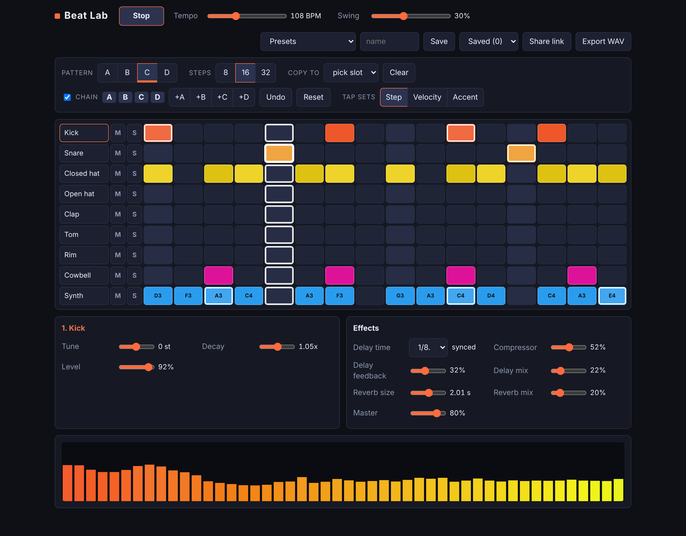
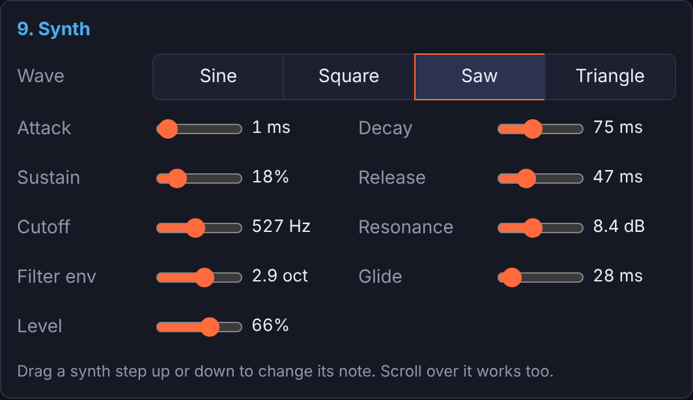

# Day 020: beat-lab

**Date:** 2026-11-26

## What it does

A drum machine and step synth that runs in the browser. Every sound is synthesized live with the Web Audio API: no samples, no audio libraries. Eight drum voices and a monophonic synth play on a 16 step grid with swing, velocity, accents, four pattern slots and chain mode, through a master compressor, a tempo-synced delay and a reverb built from a generated impulse response. A whole beat fits in a share link, and Export WAV renders four bars offline to a 16-bit file.





Listen to the built-in preset, rendered by the Export button: [docs/commit-to-curiosity.wav](docs/commit-to-curiosity.wav) (10.4 s, stereo, 44.1 kHz, 1.8 MB).

## Why I built it

I wanted to know how little it takes to make a drum kit sound like one. A kick is a sine wave that falls in pitch, a snare is noise plus a tone, a hi-hat is noise through a high-pass filter. The second question was timing: why do naive `setInterval` sequencers drift and stutter, and what does it take to make one that does not.

## Tech used

- TypeScript, Vite (vanilla TS, no framework)
- Web Audio API only: oscillators, filtered noise, `DynamicsCompressorNode`, `DelayNode`, `ConvolverNode`, `AnalyserNode`, `OfflineAudioContext`
- Canvas for the spectrum visualizer
- vitest with v8 coverage, using a recording mock of the Web Audio API so the core runs in Node
- Playwright (headless Chromium) for the screenshots and for checking the exported WAV

## How to run

```bash
npm install
npm run dev        # http://localhost:5173, press Play or hit space
npm test           # 336 tests
npm run test:cov   # with coverage, fails under 85%
npm run build      # typecheck and production build
```

If `npm install` fails with an `edgesOut` error on an old npm, run `npm install --legacy-peer-deps`.

## How sound is synthesized

Each hit builds a small graph of nodes, schedules its envelope in advance, and lets the nodes stop themselves. Here is the kick, the simplest voice:

```
 sine oscillator ---------------------------> amp gain ----------> master bus
   freq: 225 Hz --(exp ramp, 110 ms)--> 50 Hz   gain: peak, then
                                                setTarget -> 0 (tau 90 ms)
 noise burst -> high-pass 2.5 kHz -> click gain -> master bus
                                     (tau 4 ms, 35% of peak)
```

The pitch sweep gives the thump, the long decay gives the boom, and the 4 ms click of high-passed noise gives the beater attack. Tune scales every frequency by up to an octave either way, Decay scales every time constant, and Level sets the peak gain.

| Drum | Recipe |
|------|--------|
| Kick | Sine swept from 4.5x down to its base pitch, plus a noise click |
| Snare | High-passed noise, plus a triangle tone that falls from 210 to 150 Hz |
| Closed hat | Noise, high-pass 7 kHz, band-pass 10.5 kHz, very short decay |
| Open hat | Same filters, long decay. A closed hat **chokes** it: the open hat's gain is pulled to zero in 3 ms |
| Clap | Three 3.5 ms noise bursts 11 ms apart, then a longer tail, all band-passed near 1.1 kHz |
| Tom | Sine swept from 1.9x down to its pitch |
| Rim | Triangle at 1.65 kHz and sine at 480 Hz, plus a noise click |
| Cowbell | Two square waves (540 and 800 Hz) through a band-pass |

The 8th drum track is a cowbell because the brief asked for 8 drum tracks and listed 7 voices.

The synth voice is `oscillator -> low-pass filter -> amp -> cut gain -> master bus`. The ADSR is piecewise linear and defined once as a pure function (`adsrLevel`) and once as a list of breakpoints that is sent to Web Audio (`planEnvelope`); a test checks the two agree everywhere, including when the key is released halfway through the attack. The filter envelope drives the filter's `detune` parameter, which is in cents, so a linear ramp there is an exponential sweep of the cutoff. Glide is an exponential ramp from the previous note's frequency. The synth is monophonic: a note that starts while the last is still sounding cuts it off in 4 ms.

### Why the scheduler does not drift

A JavaScript timer is only used to wake the scheduler up. It is late by a few milliseconds, jittery, and throttled in background tabs, so it never decides when a sound plays. The audio clock does.

```
audio clock:   now ------------------------------> now + 150 ms
steps:         | step n | step n+1 | step n+2 |  step n+3 (outside: not yet)
timer wakes:   ^25ms     ^25ms      ^25ms       ^25ms ...

each wake-up: schedule every step whose time < now + lookahead,
              with an exact start time on the audio clock.
              The audio thread plays it sample-accurately,
              however late the timer woke up.
```

Each step is scheduled several times' worth of wake-ups ahead, so a 40 ms stall does not make a hit late. If the tab is starved for more than 250 ms the scheduler skips ahead instead of firing a burst of old steps. Swing delays only the odd (off-beat) steps by a share of one step, up to 75%, so steps never cross.

## Controls reference

| Control | What it does |
|---------|--------------|
| Play / Stop, `Space` | Start and stop. Audio starts on the first click, as browsers require |
| Tempo | 60 to 200 BPM. `Up` / `Down` nudge by 1, with `Shift` by 10 |
| Swing | 0 to 75% |
| Pattern A to D, `[` and `]` | Select the slot to edit (and to loop when chain mode is off) |
| Steps 8 / 16 / 32 | Length of the current pattern |
| Copy to | Copy the current pattern over another slot. Clear empties it |
| Chain | Tick it to play the chain list in order, looping. Add slots with `+A` to `+D`, Undo removes the last |
| Tap sets: Step / Velocity / Accent | What a tap on a drum step does. Step: toggle, and drag across a row to paint. Velocity: cycle soft, medium, loud, full. Accent: toggle an accent (40% louder) |
| Synth steps | Tap to toggle. Drag up or down, or scroll over a step, to change its note |
| Track name, `1` to `8` (`9` for the synth) | Select a track, show its knobs, and hear it |
| M / S, `M` and `S` | Mute and solo. If anything is soloed only soloed tracks play (solo wins over mute) |
| Drum knobs | Tune (plus or minus 12 semitones), Decay, Level |
| Synth knobs | Wave (sine, square, saw, triangle), Attack, Decay, Sustain, Release, Cutoff, Resonance, Filter env, Glide, Level |
| Effects | Compressor amount, delay time (1/16 to 1/2, tempo synced), feedback, mix, reverb size and mix, master |
| Presets | Boom bap, House, Trap, commit-to-curiosity |
| Save / Saved | Store beats in this browser's localStorage |
| Share link | Copies a URL that recreates the beat exactly |
| Export WAV | Renders 4 bars (plus a 1.5 s tail) offline and downloads a 16-bit stereo WAV |

## Sharing and saving

The whole state is small integers (every knob is 0 to 100), so it packs into bits: a version byte, tempo, swing, the chain, then for each of the four patterns a 32-bit mask of which steps are on per track and 5 bits (accent and velocity, plus 7 for the note on the synth) for each step that is on. A 16-bit Fletcher checksum goes on the end. The result is base64url in `#b=...`.

- An empty beat is 251 characters and the built-in presets are 303 to 355. The worst case, every step of every pattern on at 32 steps with every knob maxed, is 1,363, and a test keeps it under 2,000.
- A link that is cut off, edited, from another version, or just wrong is rejected with a message that says which of those it is, and the app starts normally.
- localStorage access is wrapped in try/catch. If the browser blocks it (private windows, full quota) saves fall back to memory for the visit and the status line says so.

## Layout

```
src/
  audio-context.ts  context creation, resume, dB/MIDI/knob maths, seeded noise
  drums.ts          the eight drum voices and the hi-hat choke
  synth.ts          ADSR maths and the monophonic synth voice
  scheduler.ts      lookahead scheduler, step times, swing
  sequencer.ts      steps, velocity, accents, mute/solo, copy, chain
  effects.ts        compressor, tempo-synced delay, generated-IR reverb
  state.ts          the beat as data, plus validation
  url-codec.ts      bit-packed share links with a checksum
  wav.ts            16-bit WAV encoder
  presets.ts        four beats in a small text notation
  storage.ts        localStorage with graceful fallback
  render.ts         offline 4-bar render
  engine.ts         wires sequencer, scheduler and voices; owns the context
  controls.ts       knob specs, key map, formatting (DOM free)
  visualizer.ts     spectrum bars (draws to any 2D-context-like object)
  ui.ts, tools.ts   DOM glue
tests/              vitest, with a recording mock of the Web Audio API
tools/screenshots.mjs   README screenshots and WAV check with Playwright
```

## Tests

336 tests run in Node against a mock `AudioContext` that records every node, connection and automation event. Coverage over the 15 core modules is 99.8% statements and 98.0% branches (the DOM glue in `ui.ts` and `tools.ts` is checked by hand and with Playwright). They cover:

- Scheduler step times at 60 to 200 BPM and 8, 16 and 32 step patterns, swing on off-beats only, and no step ever scheduled outside the lookahead window
- ADSR levels at key times, and release during the attack and during the decay
- Step and note toggling, velocity, mute and solo, pattern copy and chain order
- URL codec round trips for every field, under 2,000 characters in the worst case, and clear errors for corrupt hashes
- WAV header, sizes and clamping to the 16-bit range
- Every preset validates, loads and survives a share link
- localStorage failures fall back to memory

Screenshots and the demo WAV come from `node tools/screenshots.mjs` against the dev server. It also decodes the exported file in Chromium, plays it, and prints its length and loudness.

## What I learned

- Scheduling on the audio clock is not harder than `setInterval`, it just moves the question from "when does my callback run" to "what is the clock reading". Once that is the only source of time, tests can drive it with a fake clock and a fake timer and check exact step times.
- Making the state canonical (an off step always has the default velocity, accent and note) is what makes "round trips every field exactly" true, and it let the codec skip all the data for empty steps.
- `setTargetAtTime` envelopes are easy to choke: a later `setTargetAtTime` simply takes over from wherever the curve is. Ramps are not.
- A CSS class named `play` on both the transport button and the playhead cells made one column of the grid 30 px too wide. Namespacing matters even in a 400 line stylesheet.

## Ideas to extend

- Per-step probability and ratchets
- A piano roll for the synth and more than one synth step per note length
- Sidechain the synth to the kick
- A second synth voice and a real step-level filter lock
- MIDI out, or recording the live mix with `MediaRecorder`

## Author

**Jashwanth Neela** · [GitHub](https://github.com/NJashwanth)
