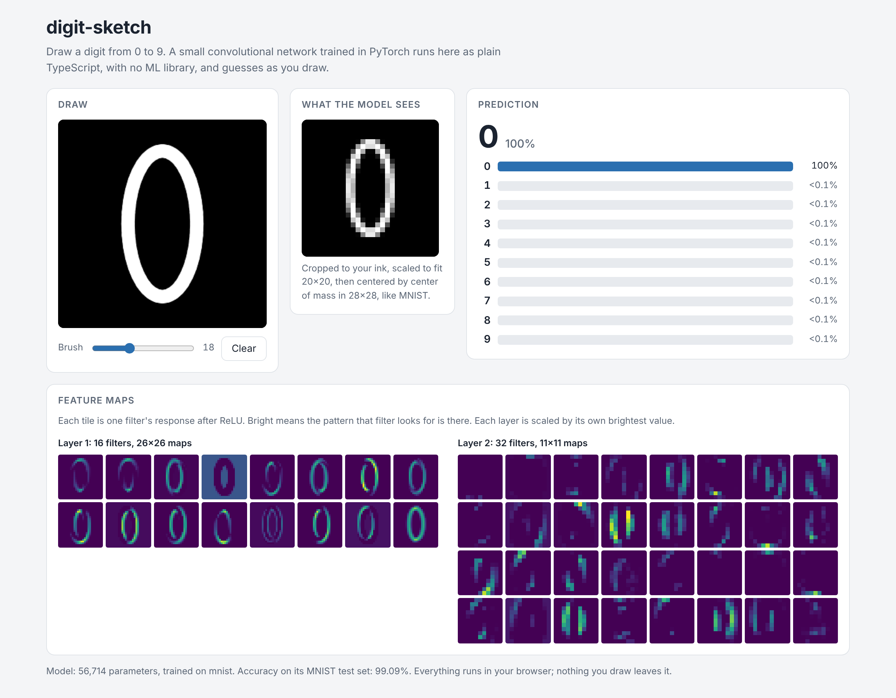
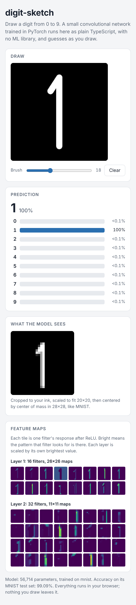
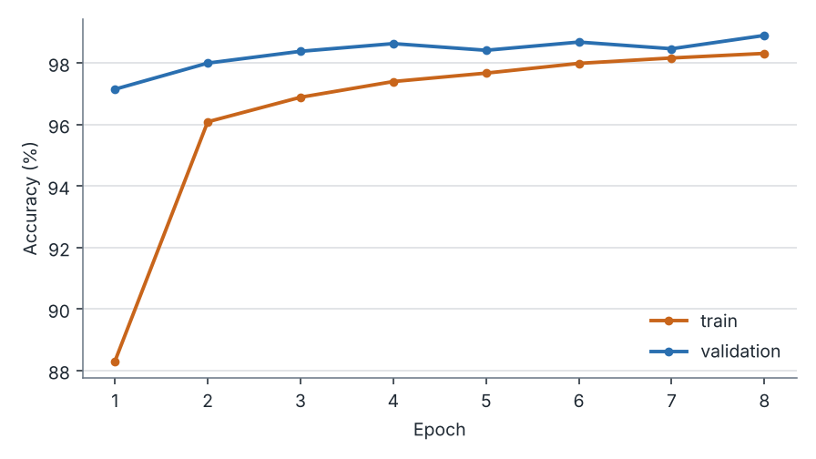
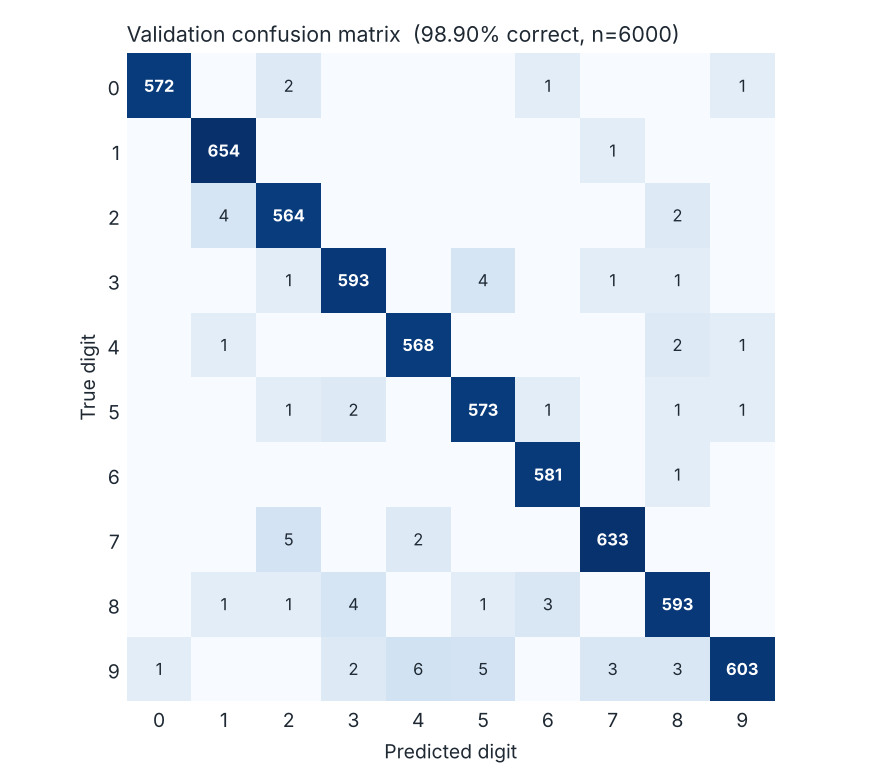
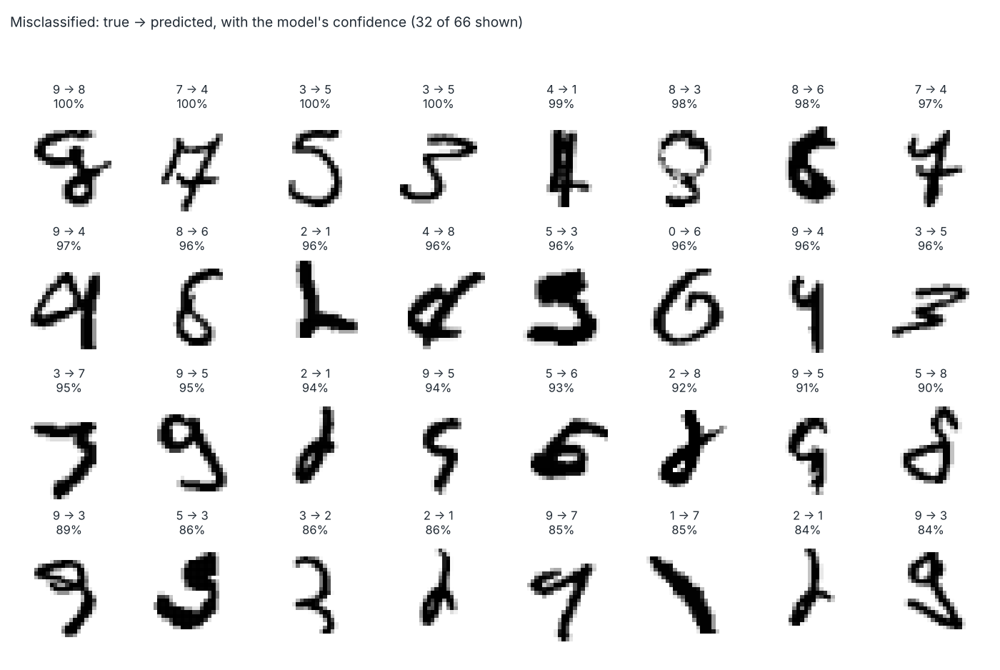

# Day 021: digit-sketch

**Date:** 2026-11-27

## What it does

A handwritten digit recognizer in two halves. A small CNN is trained in PyTorch on CPU and its weights are exported to a 637 KiB JSON file. A from-scratch TypeScript inference engine (no ML libraries, just loops over `Float32Array`s) loads that file in the browser and guesses the digit you draw, live, while you draw it. Next to the probability bars it shows the 28x28 image the model actually receives and the activations of both conv layers.


| | |
|---|---|
|  |  |

On a phone the cards stack, and touch works (checked with real touch events, see [Testing the app](#testing-the-app)):



## Why I built it

I wanted to see a CNN end to end with nothing hidden: not just `model.fit`, but the exact arithmetic that turns a pixel grid into "that is a 7". The test of understanding was writing the forward pass a second time in another language and having it agree with PyTorch to 1e-5. The second question was the gap between a clean benchmark and a person scribbling on a canvas, which is why preprocessing, and what happens when the training data is not real handwriting, got as much attention as the network.

## Tech used

- Python, PyTorch (CPU), NumPy, Pillow, matplotlib, pytest and pytest-cov
- TypeScript, Vite (vanilla TS, no framework), Canvas and Pointer Events
- vitest with v8 coverage
- Playwright (headless Chromium) for the screenshots and an end to end check of mouse and touch input

## How to run

```bash
# 1. Train, then export the weights (and the parity fixtures the TypeScript tests use)
cd train
pip install -r requirements.txt          # CPU-only torch via the extra index in that file
python train.py --epochs 8               # downloads MNIST on first run, about 5 minutes on 4 CPU cores
python export.py --out ../web/public/model.json

# 2. Run the app
cd ../web
npm install                              # add --legacy-peer-deps if an old npm fails with an `edgesOut` error
npm run dev                              # http://localhost:5173
```

A trained `model.json` is already committed, so step 2 works on a fresh clone without training.

```bash
# Tests, all local (there are no GitHub Actions in this repo)
cd train && pip install -r requirements-dev.txt && pytest --cov     # 84 tests, takes about 4 minutes (they train tiny models)
cd web && npm test                                                  # 89 tests, about 1 second
cd web && npm run test:cov                                          # fails under 85% coverage
cd web && npm run build                                             # typecheck and production build
```

`train.py` options worth knowing: `--source auto|mnist|synthetic`, `--augment auto|none|light|heavy`, `--seed`, `--out-dir`. Everything it writes (checkpoint, `metrics.json`, plots) goes to `train/runs/latest/`, which is git-ignored along with `train/data/`.

## How a CNN sees a digit

Every layer in this network is a 3x3 filter sliding over the layer before it. There is no padding, so each convolution trims one pixel off every side, and each max pool halves the size.

```
 INPUT  1 x 28 x 28                     one 3x3 filter (9 weights + 1 bias)
 +----------------------------+         slides one pixel at a time:
 |  .  .  .  .  .  .  .  .   |
 |  .  [a b c] .  .  .  .  .  |         step 1      step 2       ...    last (step 26)
 |  .  [d e f] .  .  .  .  .  |         [a b c]      . [a b c]          . . [a b c]
 |  .  [g h i] .  .  .  .  .  |         [d e f]      . [d e f]          . . [d e f]
 |  .  .  .  .  .  .  .  .   |         [g h i]      . [g h i]          . . [g h i]
 +----------------------------+
   at each position: out = bias + sum(weight[k] * pixel[k] over the 9 pixels)
   28 - 3 + 1 = 26 positions per row, 26 rows

        conv1: 16 filters, each makes one map         params: 16 * (9 + 1)              =    160
 28x28 ---------------------------------> 16 x 26 x 26
        ReLU: max(0, x), keeps only "pattern found"
        maxpool 2x2: keep the biggest of each 2x2 block
                                         16 x 13 x 13

        conv2: 32 filters, each 3x3 over ALL 16 maps  params: 32 * (16 * 9 + 1)       =  4,640
                                         32 x 11 x 11     (one filter = a 16 x 3 x 3 block,
        ReLU                                               it adds up what all 16 maps say
        maxpool 2x2 (odd 11 -> 5, the last row and column are dropped)
                                         32 x 5 x 5       about that 3x3 neighbourhood)

        flatten: 32 * 5 * 5 = 800 numbers in a row
        dense 800 -> 64, ReLU                         params: 800 * 64 + 64           = 51,264
        dense 64 -> 10                                params: 64 * 10 + 10            =    650
        softmax: 10 scores -> 10 probabilities that sum to 1
                                                                          total        56,714
```

What the two layers pick up, as seen in the app's feature maps:

- **Layer 1** looks at 3x3 pixel patches, so it can only detect tiny things: an edge in one direction, a stroke end, a bit of curve. Each of its 16 maps is the digit again, lit up wherever its edge shows up (the screenshot at the top shows this).
- **Layer 2** sees 3x3 positions of layer 1 *after pooling*, so each of its cells covers about 8x8 input pixels. Its 32 maps are coarse (11x11) and respond to combinations: a vertical bar with a hook on top, a closed loop, a crossing.
- The dense layers then weigh those 800 "is this combination present, and where" numbers into ten scores.

### Preprocessing matters as much as the network

MNIST digits are not raw photos: each one was cropped to its ink, scaled to fit a 20x20 box (keeping the aspect ratio), and pasted into a 28x28 field so that its center of **mass** (not its bounding box) is the middle. A model trained on that sees nonsense if you feed it a canvas screenshot, so the app does the same recipe to your drawing (`web/src/preprocess.ts`). The same recipe is written in Python (`train/preprocess.py`) for the synthetic dataset, and a shared fixture file checks that both give the same 28x28 pixels (within 1e-5) on eight different drawings, including a single dot, a faint bar and an L shape whose mass is far from its box center.

One bug that testing found: a perfectly symmetric stroke puts the center of mass on an exact rounding tie (x.5), and NumPy and a JavaScript loop sum in different orders, so floating point noise put it just below .5 in one language and just above in the other, shifting the digit by a pixel. Both sides now round with a 1e-9 nudge so ties always go the same way.

## Results

### Which dataset was used

**Real MNIST**, downloaded from the GitHub-hosted mirror `fgnt/mnist` (`raw.githubusercontent.com`), with each of the four archives checked against the official MD5. The synthetic-font fallback (below) was not needed. The source is recorded in `docs/metrics.json` (`dataset.source`) and in `model.json` (`meta.dataset`), and the app shows it in its footer.

- 54,000 train / 6,000 validation (a seeded 90/10 split of the official 60,000 training images), plus the official 10,000 test images that were never used for training or for picking the epoch
- Normalization: `(pixel / 255 - 0.1307) / 0.3081`
- Training augmentation: light, applied on the fly to the training split only (rotation up to 10 degrees, scale 0.9 to 1.1, shear, 1.5 px shifts, a little elastic distortion, stroke thickness, blur and noise). Validation and test images are untouched. This is there so hand-drawn strokes, which are a different thickness and a little wobblier than MNIST's, do not trip the model.

### Accuracy

Adam, learning rate 1e-3, batch 128, 8 epochs, seed 0, 56,714 parameters, about 38 seconds per epoch (about 5 minutes total) on 4 CPU cores. The epoch with the best validation accuracy is kept (it was the last one).

| Epoch | Train loss | Train acc (augmented) | Validation acc |
|------:|-----------:|----------------------:|---------------:|
| 1 | 0.3885 | 88.30% | 97.15% |
| 2 | 0.1265 | 96.09% | 98.00% |
| 3 | 0.0996 | 96.89% | 98.38% |
| 4 | 0.0838 | 97.40% | 98.63% |
| 5 | 0.0760 | 97.67% | 98.42% |
| 6 | 0.0656 | 97.99% | 98.68% |
| 7 | 0.0575 | 98.17% | 98.47% |
| 8 | 0.0536 | 98.31% | **98.90%** |

**Validation accuracy 98.90% (6,000 images, 66 wrong). Official MNIST test accuracy 99.09% (10,000 images, 91 wrong).** Training accuracy sits below validation because it is measured on the augmented images while the model is still changing.



### Confusion matrix (validation, rows are the true digit)

```
true\pred    0    1    2    3    4    5    6    7    8    9
        0  572    0    2    0    0    0    1    0    0    1
        1    0  654    0    0    0    0    0    1    0    0
        2    0    4  564    0    0    0    0    0    2    0
        3    0    0    1  593    0    4    0    1    1    0
        4    0    1    0    0  568    0    0    0    2    1
        5    0    0    1    2    0  573    1    0    1    1
        6    0    0    0    0    0    0  581    0    1    0
        7    0    0    5    0    2    0    0  633    0    0
        8    0    1    1    4    0    1    3    0  593    0
        9    1    0    0    2    6    5    0    3    3  603
```



The 9 is the hardest digit (it is the true label in 20 of the 66 errors, most often read as a 4 or a 5), then 8 (10 errors), then 3 and 7 (7 each). The most common single confusion is 9 read as 4 (6 times), followed by 7 as 2 and 9 as 5 (5 each). On the whole 10,000-image test set the top confusions are 9 as 8 (9), 7 as 2 (7), 6 as 5 (6) and 3 as 5 (4).

### What it gets wrong



Most of these are digits a person would pause on too: a 9 with a closed bottom loop that really does look like an 8, a 3 written like a 5, a heavy blob that is half a 5 and half a 3. A few (the thick 4 read as a 1 at 99%, the thin 2 read as a 1 at 94%) look like plain model mistakes. The model does not know when it is out of its depth: those wrong answers are the most confident ones, which is typical for softmax outputs.

### Does the TypeScript engine agree with PyTorch?

| Check | Result |
|-------|--------|
| NumPy forward pass over the exported JSON vs PyTorch, 500 real test images | max probability difference **7.4e-7**, all predictions identical (the requirement was 1e-5) |
| TypeScript engine vs PyTorch, 20 fixture images (2 per digit) | same prediction on all 20, probabilities within 1e-4 |
| Each TypeScript op (conv2d, ReLU, maxpool, flatten, dense, softmax) vs PyTorch's own op, 21 seeded cases | within 1e-5 (ReLU, maxpool and flatten exactly equal) |

Weights are written to 7 significant digits. I first tried 6: the NumPy-vs-PyTorch difference was 9.7e-6, which passes 1e-5 with no room to spare, so I went to 7 (float32 holds about 7.2 digits, so nothing real is lost) and the file is 637 KiB, under the 1 MB budget.

### The fallback dataset, and why it is a fallback

If MNIST cannot be downloaded, `--source auto` renders digits from every system font that can draw all ten (105 of 109 font files here), runs them through the same MNIST-style preprocessing, and applies heavy augmentation (rotation, scale, shear, shift, elastic distortion, stroke thickness, blur, noise). One fifth of the fonts are held out entirely for the test set. I did not need it, but I trained it once to see what it is worth:

| Trained on | Test set | Accuracy |
|------------|----------|---------:|
| Real MNIST (the shipped model) | MNIST test | 99.09% |
| Synthetic fonts, same architecture, 8 epochs | fonts it has never seen | 99.08% |
| Synthetic fonts, same architecture, 8 epochs | **real MNIST test** | **79.2%** |

A model can look perfect on its own kind of data and still lose 20 points on real handwriting. Fonts do not wobble, hook or run strokes together the way hands do, and no amount of warping a font changes that. So the fallback is good enough to run the whole pipeline and for the tests, but the shipped `model.json` is trained on real MNIST.

## Testing the app

The unit tests cover the Python code and the TypeScript core; the browser glue (drawing pad, DOM rendering) is exercised end to end by `web/tools/screenshots.mjs`, which drives the real app in headless Chromium:

```bash
cd web && npm run dev                 # in one terminal
node tools/screenshots.mjs            # in another
```

It draws all ten digits with scripted mouse strokes, then saves the three screenshots above. Result on the last run:

```
drew 0..9 with the mouse -> predicted 0 1 2 3 4 5 6 7 8 9      10/10 correct
touch: drew a 1 with real touch events (CDP)  -> predicted 1
after Clear: headline "Draw a digit", all bars 0%
no console or page errors
```

Honest caveat on that 10/10: the strokes are geometrically clean scripted curves, so it shows the whole pipeline works (pointer events, canvas, preprocessing, engine, rendering), not that the model is 100% accurate on people. The 99.09% on the MNIST test set is the real accuracy number.

## Layout

```
day-021-digit-sketch/
  train/                    Python (PyTorch on CPU)
    mnist.py                download from the GitHub mirror, checksum, parse IDX
    synthetic.py            font-rendered digits (the fallback)
    augment.py              warp, elastic, thickness, blur, noise (NumPy)
    preprocess.py           crop, 20x20, center by mass (same recipe as the browser)
    dataset.py              loading, MNIST normalization, seeded split, source tracking
    model.py                the CNN (56,714 params)
    train.py, evaluate.py   Adam training, confusion matrix, misclassified plot, curves
    reference.py            pure NumPy forward pass over model.json
    export.py, fixtures.py  model.json writer + verification, and the TypeScript parity fixtures
    tests/                  84 pytest tests
  web/                      TypeScript (Vite)
    src/nn/                 tensor, ops (conv2d, relu, maxpool2d, flatten, dense, softmax), model loader
    src/preprocess.ts       the same recipe as train/preprocess.py
    src/colormap.ts, format.ts, canvas-pad.ts, view.ts, main.ts
    public/model.json       the trained network (637 KiB)
    tests/                  89 vitest tests and the Python generated fixtures
    tools/screenshots.mjs   Playwright driver
  docs/                     screenshots, plots, metrics.json
```

## Coverage

- Python: 84 tests, **99.6%** line coverage over all modules (`pytest --cov`, fails under 85%). Three lines are uncovered: the real network `fetch` in `mnist.py` (tests inject a fake one, so no test touches the network) and the branch that skips a font whose digits all render blank.
- TypeScript: 89 tests, **100%** line and statement coverage and 98.6% branch coverage of the core (`npm run test:cov`, fails under 85%). The core is the inference engine, preprocessing, colormap and formatting. `main.ts`, `canvas-pad.ts` and `view.ts` are DOM glue and are covered by the Playwright run above, not by vitest.

## What I learned

- The convolution itself is about ten lines. Nearly all of the work is in the edges around it: the exact preprocessing, number formats, checksums, and proving two implementations agree.
- A `.gz` MD5 and a decompressed-bytes MD5 are different numbers. My first checksum check rejected a perfectly good download because I hashed the wrong thing.
- Exactness has a cost: rounding the weights to 6 digits was already enough to approach my 1e-5 tolerance. Test tolerances should be set with the measured error next to them.
- Symmetric inputs produce exact ties, and ties are where two correct implementations diverge. A 1e-9 nudge in the rounding is cheaper than a debugging session.
- Training only on fonts gives a model that is excellent on fonts and mediocre on hands (79.2% on MNIST). The distribution of the data matters more than how much augmentation you pile on it.

## Ideas to extend

- Collect real drawings from the app (with consent) and fine-tune on them to close the gap between MNIST and canvas strokes
- Quantize the weights to int8 and see how small the JSON gets and what it costs in accuracy
- Add an "I am wrong" button that stores the 28x28 image and the correction
- Show which input pixels drove the answer (occlusion or saliency maps) next to the feature maps
- Port the engine to WebGL or WASM and measure when it stops being faster to just use loops

## Author

**Jashwanth Neela** · [GitHub](https://github.com/NJashwanth)
